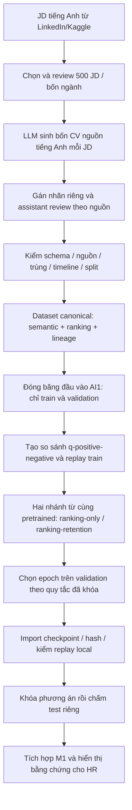
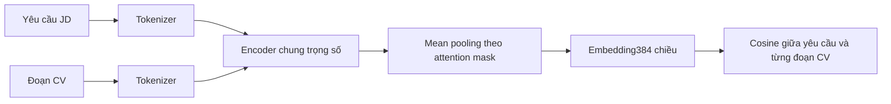
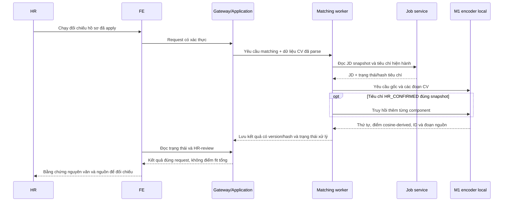

# Báo cáo quá trình xây dựng dữ liệu và huấn luyện AI1/M1 — NexHire

**Ngày đối chiếu:** 26/10/2026. **Đối tượng đọc:** sinh viên thuyết trình và hội đồng đánh giá.

Tài liệu này giải thích những gì dự án **đã thực hiện**, đối chiếu với code, cấu hình và kết quả lưu trong repo. Ví dụ minh họa được ghi riêng, không trình bày như số đo thực nghiệm. Đường dẫn tương đối bên dưới tính từ tài liệu này; đường dẫn trong khối lệnh tính từ thư mục gốc backend.

**Trạng thái hiện tại:** đã fine-tune và tích hợp model truy hồi bằng chứng vào luồng local hỗ trợ HR. Chất lượng bằng chứng vẫn còn hạn chế; chưa nghiệm thu toàn bộ AI1 hoặc phê duyệt production. Cross-Encoder reranker mới là phương án sắp thử, **chưa thuộc checkpoint và kết quả được báo cáo ở đây**.

**Cách đọc nhanh:** mục1–2 để nắm bài toán; mục8–12 để giải thích train; mục14 để báo kết quả; mục16–17 để nói rõ giới hạn và trả lời hội đồng. Các mục còn lại là căn cứ để đối chiếu khi cần hỏi sâu.

Mục lục:

1. [Tóm tắt báo cáo](#1-tóm-tắt-có-thể-dùng-để-mở-đầu-báo-cáo)
2. [Phân biệt AI1/M1/Parsing/AI2](#2-ai1-m1-cv-parsing-và-ai2-khác-nhau-thế-nào)
3. [Sơ đồ toàn quy trình](#3-toàn-bộ-quy-trình-từ-dữ-liệu-đến-model)
4. [Nguồn JD/CV](#4-bước-1--xây-dựng-nguồn-jd-và-cv)
5. [Nhãn, negative và review](#5-bước-2--định-nghĩa-và-review-nhãn)
6. [Dataset và chia tập](#6-bước-3--bộ-dữ-liệu-cuối-và-chia-tập-chống-rò-rỉ)
7. [Chuẩn hóa và embedding](#7-bước-4--chuẩn-hóa-văn-bản-và-biểu-diễn-embedding)
8. [Fine-tune thực chất làm gì](#8-bước-5--fine-tune-thực-chất-thay-đổi-điều-gì)
9. [Thuật toán và loss](#9-bước-6--thuật-toán-của-checkpoint-đang-dùng)
10. [Recipe và một bước train](#10-bước-7--recipe-train-thực-tế-và-một-batch-được-xử-lý-thế-nào)
11. [Kaggle và xuất model](#11-bước-8--chạy-trên-kaggle-và-xuất-model)
12. [Chọn và kiểm checkpoint](#12-bước-9--chọn-checkpoint-và-xác-minh-train-có-thật)
13. [Các lần train trước](#13-các-lần-train-trước-và-vì-sao-không-dùng-chúng-làm-checkpoint-cuối)
14. [Metric và final test](#14-bước-10--đánh-giá-đúng-bài-toán-truy-hồi)
15. [Luồng ứng dụng thực tế](#15-bước-11--model-chạy-trong-ứng-dụng-như-thế-nào)
16. [Kiểm chứng và hạn chế](#16-bước-12--kiểm-chứng-tích-hợp-và-vấn-đề-thực-tế-mới-nhất)
17. [Bài nói và hỏi đáp](#17-cách-trình-bày-với-hội-đồng-và-trả-lời-câu-hỏi)
18. [Các file đối chiếu](#18-đầu-mối-file-để-kiểm-tra-và-tái-hiện)
19. [Tài liệu lý thuyết](#19-tài-liệu-lý-thuyết-tham-khảo)

## 1. Tóm tắt có thể dùng để mở đầu báo cáo

> NexHire sử dụng Sentence Transformer đa ngôn ngữ để biểu diễn yêu cầu tuyển dụng và các đoạn thông tin CV thành vector. Nhóm fine-tune encoder pretrained bằng dữ liệu tuyển dụng có nhãn, theo mục tiêu đưa bằng chứng đúng lên trên bằng chứng không phù hợp. Model được chọn dùng cosine triplet ranking loss kết hợp retention loss để hạn chế mất biểu diễn của model gốc. Khi chạy, model truy hồi tối đa ba đoạn CV cho từng yêu cầu, giữ nguồn trích dẫn để HR kiểm tra. Điểm trả về thể hiện độ tương đồng, không phải xác suất ứng viên đáp ứng yêu cầu hay quyết định tuyển dụng.

Các con số chính:

| Nội dung | Giá trị đã xác minh |
|---|---|
| Nguồn dữ liệu tổng hợp | 500 JD, 2.000 CV tiếng Anh; bốn ngành, mỗi ngành125 JD |
| Semantic dataset hiện hành | 10.508 dòng EN/VI, tương ứng5.254 nhóm yêu cầu–bằng chứng |
| Model gốc | `sentence-transformers/paraphrase-multilingual-MiniLM-L12-v2` |
| Checkpoint đang dùng | `ranking-retention`, thuộc AI1 |
| Đầu vào ranking loss của lần train được chọn | 1.233 nhóm so sánh, mỗi nhóm có hai biến thể EN/VI |
| Dữ liệu retention | 5.814 văn bản train duy nhất |
| Huấn luyện đầy đủ | GPU Tesla T4 trên Kaggle, 3 epoch, 465 bước cập nhật mỗi nhánh |
| Checkpoint xuất của nhánh đang dùng | Epoch1, bước155; không phải epoch cuối |
| Vector / giới hạn văn bản | 384 chiều / 256 token mỗi văn bản |
| Final known-citation MRR | Fine-tuned0,6396; pretrained0,5690; BM250,5577 |
| Final known-citation Hit@3 | Fine-tuned86,50%; pretrained79,07%; BM2582,18% |
| Giới hạn của các metric trên | Nhãn assistant silver; đo truy hồi citation đã biết, không đo độ chính xác tuyển dụng |

## 2. AI1, M1, CV Parsing và AI2 khác nhau thế nào?

| Tên | Vai trò trong NexHire | Có phải model đang giải thích trong tài liệu này? |
|---|---|---|
| CV Parsing | Đọc CV thành dữ liệu có cấu trúc: kỹ năng, kinh nghiệm, dự án, học vấn… | Không; đây là chuẩn hóa đầu vào |
| M1 | Encoder Sentence Transformer đã fine-tune; biến văn bản thành embedding để truy hồi | Có |
| AI1 | Chức năng yêu cầu–bằng chứng: chuẩn hóa, gọi M1, giữ nguồn, trả kết quả giải thích và hiển thị HR | Có, nhưng phạm vi rộng hơn riêng encoder |
| AI2 | Dự đoán/xếp hạng mức phù hợp **ứng viên–công việc** từ đặc trưng | Không; cần thực nghiệm Logistic Regression, Random Forest, XGBoost riêng |
| Verifier | Các thử nghiệm lịch sử từng dùng để đánh giá mức hỗ trợ của đoạn văn | Adapter `local_m1` hiện không gọi verifier hoặc verifier fallback; support giữ chưa xác minh |
| Reranker đề xuất | Chọn lại các đoạn sau truy hồi | Chưa thử/chọn vào runtime trong phạm vi báo cáo này |

Tên file `train_ranking.py` và model `ranking-retention` dễ gây nhầm. Chữ **ranking ở đây là thứ tự các đoạn bằng chứng cho một yêu cầu**, không phải bảng Top-K ứng viên của AI2.

Ví dụ:

- AI1 hỏi: “Với yêu cầu triển khai dịch vụ trên AWS, đoạn nào trong CV này đáng đọc nhất?”
- AI2 hỏi: “Trong nhiều ứng viên của vị trí này, nên ưu tiên HR xem ứng viên nào?”

## 3. Toàn bộ quy trình từ dữ liệu đến model



LLM tham gia tạo nguồn và đề xuất annotation. **LLM không thực hiện gradient descent để train encoder, không sinh embedding của M1 và không được dùng để bịa điểm cosine.** Python/PyTorch mới thực hiện huấn luyện thực tế.

## 4. Bước 1 — Xây dựng nguồn JD và CV

### 4.1. Nguồn và phạm vi

Đầu vào thực tế là JD tiếng Anh từ bộ LinkedIn/Kaggle, luồng chạy dùng `postings.csv`. Sau pilot chỉ IT, dự án chuyển sang bốn nhóm phù hợp với nền tảng tuyển dụng đa ngành:

| Nhóm | Số JD | Số CV nguồn |
|---|---:|---:|
| IT / Data |125|500|
| Sales / Marketing |125|500|
| Finance / Accounting |125|500|
| HR / Recruitment |125|500|
| Tổng |500|2.000|

Đã có các revision lựa chọn nguồn để xử lý trùng/gần trùng và JD phân ngành không đúng nhiệm vụ. Không xem việc lấy từ Kaggle là bảo đảm dữ liệu không trùng hoặc nhãn đã đúng. Bộ hiện hành được nhận diện bằng [CURRENT_DATASET.json](../../dataset/CURRENT_DATASET.json), không lấy ngẫu nhiên dữ liệu pilot trong `runs/`.

### 4.2. Cách sinh CV và vì sao tách bước gán nhãn

LLM sinh bốn hồ sơ hư cấu cho mỗi JD, có nền tảng và độ phù hợp dự kiến khác nhau. Qua pilot, cơ chế vừa sinh CV vừa tự cho nhãn không nhất quán nên được tách:

1. Sinh nội dung CV nguồn.
2. Review chất lượng nguồn.
3. Đọc lại JD/CV để trích yêu cầu, neo nguồn và đề xuất annotation.
4. Assistant review, sửa hoặc giữ ngoài những trường hợp chưa đủ căn cứ.
5. Chỉ xuất bản ghi được chính sách cho phép; giữ nguyên dữ liệu và lý do loại để truy vết.

**Bốn CV không có nghĩa bộ cuối luôn có đúng một nhãn0,1,2,3 cho mỗi JD.** Ý định khi sinh không phải nhãn chuẩn. Ép nhãn cân bằng sau khi đọc CV sẽ làm sai dữ liệu.

Prompt thực tế được giữ ở [generation_prompt.json](../../dataset/current/generation_prompt.json) và [annotation_prompts.json](../../dataset/current/annotation_prompts.json). Không nên đưa prompt pilot đầu tiên vào báo cáo như thể nó là prompt cuối.

### 4.3. Cơ chế Anh–Việt

- CV nguồn chủ yếu là tiếng Anh.
- Mỗi yêu cầu có biến thể tiếng Anh và tiếng Việt tương đương; giữ thuật ngữ, số năm, điều kiện và required/preferred.
- Một bằng chứng CV tiếng Anh có thể ghép với yêu cầu EN và VI.
- Hai biến thể cùng một nguồn có cùng split; trọng số biến thể0,5.

Ví dụ minh họa:

```text
q_en: Deploy backend services on AWS.
q_vi: Triển khai dịch vụ backend trên AWS.
e_en: Deployed the reporting API on AWS ECS and monitored it with CloudWatch.
```

Đó là **một nhóm nguồn với hai cách diễn đạt**, không phải hai ứng viên hoặc hai bằng chứng độc lập. Không nhân500 JD thành1.000 JD và không tuyên bố đã đánh giá CV tiếng Việt tương đương mức CV tiếng Anh.

## 5. Bước 2 — Định nghĩa và review nhãn

### 5.1. Ba loại nhãn phải phân biệt

| Cấp | Ý nghĩa | Ví dụ |
|---|---|---|
| Quan hệ annotation | Đoạn/CV hỗ trợ yêu cầu ở mức nào: ENTAILS, PARTIAL, NOT_MENTIONED, IRRELEVANT… theo protocol | Có làm SQL nhưng thiếu cloud cho yêu cầu ghép: chỉ hỗ trợ một phần |
| Nhãn semantic binary | Cặp yêu cầu–đoạn được cho phép xuất nhãn1 hoặc0 theo review | Evidence nghiệp vụ đúng so với evidence khác ngữ cảnh |
| Nhãn fit0–3 | Mức phù hợp toàn CV với JD, phục vụ dữ liệu AI2 | Không được suy trực tiếp từ một đoạn văn |

Không mặc định `PARTIAL=0`. Không có thông tin không đồng nghĩa chứng minh ứng viên không có khả năng. `NOT_MENTIONED` không được gán một quote giả để tạo negative. Nhãn đã xuất vẫn là nhãn theo rubric được assistant review, không phải chuyên gia tuyển dụng độc lập xác nhận.

### 5.2. Negative là gì?

Một triplet có:

```text
q: yêu cầu tuyển dụng
p: đoạn được ưu tiên hơn theo nhãn nguồn
n: đoạn negative đã có nhãn và đúng phạm vi so sánh
```

Ví dụ minh họa:

| Loại | Văn bản | Vì sao? |
|---|---|---|
| Yêu cầu | Phát triển API backend bằng Java | Câu truy vấn |
| Positive | Xây REST API bằng Java và Spring Boot | Có đúng công cụ và công việc |
| Easy/random negative | Lập báo cáo chi phí marketing | Khác nghiệp vụ |
| Hard negative | Xây giao diện bằng JavaScript và React | Dễ nhầm từ khóa, nhưng khác công nghệ/vai trò |

Đây là ví dụ dạy khái niệm, không phải bản ghi đã dùng train. `random` trong bản xuất là **loại negative kế thừa**, không có nghĩa script train bốc ngẫu nhiên văn bản chưa gán nhãn để coi là sai.

### 5.3. Review và bộ luật Python làm gì?

Code kiểm tra kiểu dữ liệu, ID, nguồn quote, văn bản rỗng, timeline, trùng lặp, lineage, hash và split. Các kiểm tra này là **validation/chuẩn bị dữ liệu**, không phải model đã học khả năng hiểu nghiệp vụ.

Ví dụ: Python phát hiện quote không nằm trong nguồn. Nhưng việc “JavaScript Frontend có đáp ứng Java Backend không?” cần review ngữ nghĩa; chỉ qua schema không chứng minh nhãn đúng.

Những trường hợp chưa chắc được giữ ngoài/quarantine, thay vì sửa để đạt số lượng. Điều kiện đủ tư cách như cư trú, giấy phép lái xe, background check được tách khỏi năng lực chuyên môn theo phạm vi đã thống nhất.

## 6. Bước 3 — Bộ dữ liệu cuối và chia tập chống rò rỉ

### 6.1. Dataset canonical

Version: `continuous500-assistant-a95700a36f80` tại [dataset/current](../../dataset/current).

| Thành phần | Số liệu hiện hành |
|---|---|
| Semantic |10.508 dòng: nhãn1=7.202; nhãn0=3.306|
| Nhóm semantic song ngữ |5.254 nhóm|
| Ranking dành cho AI2 |1.376 dòng/344 JD; nhãn0/1/2/3=309/369/528/170|
| Nguồn vẫn giữ để đối chiếu |500 JD/2.000 CV|
| Chất lượng nhãn |Synthetic, assistant-reviewed silver; không gold độc lập|
| Cờ readiness |`training_ready=false`, `experimental_pipeline_inputs_ready=true`|

Giải thích readiness: dự án đã chuẩn bị và thực nghiệm fine-tune trên đầu vào được đóng băng; **không được đổi cách gọi thành bộ dữ liệu đã đạt chuẩn production**. Manifest còn giới hạn về độ phủ tiêu chí:347 JD đạt kiểm tra coverage theo chính sách hiện tại. Không trình bày500 JD như500 rubric đầy đủ đã được chuyên gia chứng nhận.

### 6.2. Chia theo nguồn, không xáo trộn tùy ý từng dòng

Chính sách split giữ các nhóm nguồn liên quan, JD/CV snapshot và cặp song ngữ cùng tập; kiểm trùng cặp văn bản đã chuẩn hóa giữa các split. Mục tiêu là tránh model đã nhìn một yêu cầu/CV trong train rồi được chấm lại qua bản dịch ở test.

| Tập | JD nguồn được gán | Dòng semantic canonical | Nhãn1 / nhãn0 |
|---|---:|---:|---:|
| Train |348|7.410|5.098 /2.312|
| Validation |76|1.492|994 /498|
| Test |76|1.606|1.110 /496|

Một JD test không có semantic binary được xuất, nên file semantic test có75 JD, trong khi corpus nguồn test vẫn có76 JD/304 CV. Các mẫu số này đo các đơn vị khác nhau.

Ví dụ rò rỉ cần tránh:

```text
Train: yêu cầu tiếng Anh + bằng chứng CV A
Test:  bản dịch tiếng Việt của cùng yêu cầu + cùng bằng chứng CV A
```

Kết quả tốt trên ví dụ đó không chứng minh tổng quát hóa. Code hợp đồng nằm ở [ml/datasets.py](../../apps/matching-service/ml/datasets.py); split nguồn nằm ở [split_manifest.json](../../dataset/current/split_manifest.json).

### 6.3. Từ canonical đến đầu vào lần train được chọn

Không dùng toàn bộ file semantic canonical nguyên xi. Revision review train giữ ngoài21 nhóm song ngữ chưa chắc, tương ứng42 dòng, mà không thay validation:

| Đầu vào đóng băng cho thí nghiệm được chọn | Số lượng |
|---|---:|
| Semantic train sau review |7.368 dòng/348 JD:5.098 positive,2.270 negative|
| Semantic validation giữ nguyên |1.492 dòng/76 JD|
| So sánh trực tiếp dùng ranking loss |1.233 nhóm thuộc302 JD train|
| Số biến thể so sánh EN/VI |2.466|
| Negative trong1.233 nhóm |1.001 random,232 hard|
| So sánh bị giữ ngoài sau review tương đối |3|
| Replay train duy nhất |5.814 văn bản|
| Validation retrieval |552 query nguồn/76 JD →1.104 biến thể EN/VI|

**Không nói “model được train bằng toàn bộ7.368 cặp như các triplet độc lập”.** Nguồn này được dùng để tạo1.233 so sánh hợp lệ và stream replay riêng. Các tổ hợp dùng chung yêu cầu hoặc evidence có tương quan.

Đầu mối chính xác: [experiment.json](../../training/ai1/input/ranking-b503be5ab1a1/experiment.json). Test và CV cá nhân không nằm trong input train này.

## 7. Bước 4 — Chuẩn hóa văn bản và biểu diễn embedding

### 7.1. Chuẩn hóa nào thực sự vào encoder?

`normalize_semantic_text()` trong [normalizer.py](../../apps/matching-service/app/matching/normalizer.py) thực hiện:

1. Chuẩn Unicode NFKC.
2. Gom nhiều khoảng trắng thành một.
3. Bỏ khoảng trắng đầu/cuối.
4. Chuyển chữ thường.

Hàm semantic **không bỏ dấu tiếng Việt, không tự đổi Azure thành AWS, không đồng nhất SQL với NoSQL**. Các hàm chuẩn hóa kỹ năng/lexical khác trong cùng file có mục đích riêng; không đánh đồng chúng với đầu vào encoder.

Văn bản gốc và ID vẫn giữ để trích dẫn. Tokenizer cắt văn bản đưa vào model ở256 token; runtime kiểm tra và cảnh báo nếu có văn bản dài bị cắt. Quote giữ toàn đoạn nguồn không có nghĩa model đã đọc hết toàn đoạn vượt giới hạn.

### 7.2. Kiến trúc thực tế

Model gốc: `sentence-transformers/paraphrase-multilingual-MiniLM-L12-v2`, revision được khóa:

```text
e8f8c211226b894fcb81acc59f3b34ba3efd5f42
```

Cấu hình artifact cho biết transformer12 tầng, hidden size384,12 attention heads; mean pooling tạo vector384 chiều. Giới hạn dùng trong train/inference là256 token, dù cấu hình backbone có `max_position_embeddings=512`.



“Encoder chung” nghĩa cùng một bộ trọng số xử lý các văn bản; không có một model riêng cho từng ứng viên. Mean pooling lấy trung bình vector token hợp lệ, không tính token padding như nội dung thật.

### 7.3. Cosine và điểm0–100

Với hai vector `u`, `v`:

\[
\operatorname{cos}(u,v)=\frac{u\cdot v}{\|u\|\|v\|}
\]

Runtime chuẩn hóa độ dài vector nên tích vô hướng tương ứng cosine. Điểm hiển thị:

\[
s=50\,[\operatorname{clip}(\operatorname{cos}(u,v),-1,1)+1]
\]

Ví dụ minh họa: cosine0,6 →80 điểm; cosine0 →50 điểm. Vì vậy **80/100 không có nghĩa đáp ứng80%**, và50 không có nghĩa có50% năng lực. Đây là phép đổi thang tuyến tính, không phải xác suất được hiệu chỉnh.

## 8. Bước 5 — Fine-tune thực chất thay đổi điều gì?

Fine-tune bắt đầu từ trọng số pretrained, đưa yêu cầu và evidence tuyển dụng qua encoder, tính loss, lan truyền ngược gradient rồi cập nhật trọng số transformer bằng AdamW.

Không phải chỉ:

- Viết một prompt dài cho LLM.
- Đặt một ngưỡng cosine mới.
- Sửa trọng số cộng điểm của AI2.
- Lưu embedding của dataset mà không cập nhật model.

Hai nhánh của thí nghiệm hiện tại **đều khởi tạo từ cùng pretrained**, không nối tiếp “v1 →v2 →v3 →retention” như một chuỗi tiếp tục train. `ranking-retention` không phải model contrastive v3 được nạp lại để train tiếp.

Bằng chứng đã train: receipt có optimizer steps, lịch sử loss, probe tham số thay đổi, checkpoint weights mới và kiểm tra nạp lại kết quả. Probe kiểm một ma trận tham số khác trước/sau; không được dùng nó để tuyên bố mọi tham số đều thay đổi.

## 9. Bước 6 — Thuật toán của checkpoint đang dùng

### 9.1. Phương pháp: học thứ tự có giám sát, cộng giữ biểu diễn pretrained

Gọi:

- `q`: yêu cầu JD.
- `p`: evidence có nhãn được ưu tiên.
- `n`: evidence negative đã có nhãn nguồn.
- `fθ`: encoder đang fine-tune.
- `fbase`: encoder pretrained đóng băng.

Đây là **cosine triplet margin ranking loss tự cài trong PyTorch**, không phải XGBoost, không phải MultipleNegativesRankingLoss và không phải mặc định gọi `TripletLoss` của thư viện với mọi cấu hình mặc định.

### 9.2. Ranking loss

\[
\ell_i=\max\{0,\ \cos(f_\theta(q_i),f_\theta(n_i))
-\cos(f_\theta(q_i),f_\theta(p_i))+m\},\quad m=0{,}1
\]

Ý nghĩa: positive cần cao hơn negative ít nhất0,1 về cosine.

Ví dụ minh họa, không phải log thật:

| Cosine(q,p) | Cosine(q,n) | Loss | Cách hiểu |
|---:|---:|---:|---|
|0,70|0,65|0,05|Đúng đã cao hơn sai, nhưng khoảng cách chưa đủ0,1|
|0,55|0,75|0,30|Đoạn sai đứng cao hơn; cần cập nhật mạnh hơn|
|0,80|0,60|0|Đã thỏa thứ tự và margin của mẫu này|

**Ranking hinge loss của một mẫu bằng0 chỉ nghĩa ràng buộc margin của mẫu đó được thỏa.** Tổng loss vẫn có thể có retention và loss của các mẫu khác; các lỗi ngữ cảnh, phủ định hoặc dữ liệu mới vẫn có thể tồn tại. Không suy model đã đúng mọi CV từ một giá trị loss0.

### 9.3. Retention loss

Teacher pretrained bị đóng băng. Trước khi train, script tính và cache embedding chuẩn hóa của5.814 text train duy nhất. Student được giữ gần embedding teacher trên stream replay:

\[
L_{ret}=\frac{1}{|R_b|}\sum_{t\in R_b}
\left[1-\cos(f_\theta(t),f_{base}(t))\right]
\]

`Rb` là phần replay của bước hiện tại; teacher không nhận gradient. Ví dụ, cosine student–teacher0,98 cho loss0,02; lệch thành0,80 cho loss0,20.

Mục đích là hạn chế student mất biểu diễn nền khi học tập nhỏ chuyên ngành. Đây là giữ biểu diễn bằng **cosine embedding retention**, không phải KL divergence giữa nhãn teacher/student, cũng không bảo đảm hết catastrophic forgetting.

### 9.4. Trọng số và loss thực tế mỗi batch

Để JD nhiều annotation hoặc ngành nhiều tổ hợp không lấn át, script dùng trọng số macro theo ngành →JD →yêu cầu →số lần lặp tổ hợp:

\[
w_t=\frac{1}{J_{family(t)}\ A_{job(t)}\ C_{job(t),anchor(t)}}
\]

Trong đó `J` là số JD có comparisons của ngành, `A` là số anchor của JD, `C` là số comparison dùng cùng anchor. Hai biến thể EN/VI mỗi cái nhận thêm hệ số0,5.

Code tính weighted mean rồi nhân `ranking_scale`; dạng tương đương là:

\[
L_b=\frac{\sum_{i\in b}w_i\ell_i}{N_b\bar w}
+\lambda L_{ret},
\]

`wi` là trọng số nhóm ×0,5, `Nb` là số biến thể trong batch, `w̄` là trọng số biến thể trung bình toàn tập. Không nên rút gọn mô tả implementation thành mean triplet không trọng số.

Các group weights cũ của bước contrastive, kể cả hệ số hard-negative3, **không phải hệ số mặc định của objective ranking mới**. Lần ranking này dùng công thức macro ở trên.

### 9.5. Hai nhánh đối chứng

| Nhánh | λ | Mục tiêu |
|---|---:|---|
| `ranking-only` |0|Chỉ học thứ tự evidence|
| `ranking-retention` |1|Học thứ tự và giữ biểu diễn pretrained|

Replay vẫn có thể được tính/ghi log trong nhánh λ=0 để quan sát, nhưng không tác động tổng loss qua thành phần retention.

Code chính: [ranking_objective.py](../../apps/matching-service/ml/ranking_objective.py), [train_ranking.py](../../apps/matching-service/ml/train_ranking.py), [macro weights](../../training/ai1/check_ranking_objective.py).

### 9.6. Vì sao không dùng MultipleNegativesRankingLoss cho checkpoint này?

MNRL thường dùng các positive khác trong batch làm negative ngầm. Ở dữ liệu này, một JD có thể có nhiều đoạn/candidate cùng đúng, và các bản dịch tương quan; coi mọi văn bản khác là negative dễ tạo false negative. Thiết kế được chọn chỉ dùng các negative train đã có nhãn, cùng JD và cùng yêu cầu.

Đây là lựa chọn thận trọng của thí nghiệm hiện tại, không phải kết luận MNRL luôn không phù hợp với tuyển dụng. Nếu đổi objective cần thiết kế batch và đánh giá riêng.

## 10. Bước 7 — Recipe train thực tế và một batch được xử lý thế nào?

### 10.1. Cấu hình đã khóa

| Tham số | Giá trị |
|---|---|
| Optimizer |`torch.optim.AdamW`|
| Learning rate cấu hình/cực đại |`2e-5` =0,00002; scheduler warmup46 bước rồi giảm tuyến tính, không phải LR ngay bước đầu|
| Weight decay |0,01|
| Epoch |3 mỗi nhánh|
| Batch |8 nhóm comparison, thường16 biến thể EN/VI; batch cuối có thể nhỏ hơn|
| Seed |42; shuffle epoch dùng42+chỉ số epoch|
| Margin cosine |0,1|
| Retention weights |Hai nhánh0 và1|
| Max sequence length |256 token|
| CPU threads cấu hình |4|
| Gradient clipping |L2 norm tối đa1|
| Scheduler |Linear warmup rồi linear decay|
| Warmup |`min(465 // 10, 50)` =46 bước|
| Số bước mỗi epoch |`ceil(1233/8)` =155|
| Tổng bước |155×3=465 mỗi nhánh; hai nhánh tổng930 bước optimizer|

Nguồn: [ranking_full.json](../../training/ai1/configs/ranking_full.json). Không có LoRA hay PEFT trong recipe này; optimizer nhận `model.parameters()` của encoder student.

Replay chia đều khoảng37–38 text mỗi bước, đi qua đủ5.814 text trong một epoch; không sao chép replay theo số lần một positive/negative lặp trong triplet.

### 10.2. Trình tự một bước cập nhật

1. Lấy8 nhóm; mở thành16 biến thể EN/VI.
2. Chuẩn hóa query, positive và negative.
3. Tokenize rồi forward qua cùng encoder để lấy ba nhóm embedding.
4. Forward các text replay của bước đó; lấy embedding teacher đã cache.
5. Tính ranking loss có trọng số và retention loss.
6. `optimizer.zero_grad()` rồi `loss.backward()`.
7. Clip gradient, gọi `optimizer.step()` và `scheduler.step()`.
8. Ghi log; hết epoch thì đo validation và replay drift.

Ví dụ log:

```text
arm=ranking-retention, epoch=1, step=25, total_steps=465,
ranking_loss=..., retention_loss=...
```

`step` đếm lần cập nhật optimizer trong nhánh. Loss ranking giảm nhưng retention tăng nghĩa encoder đang học thứ tự và đồng thời lệch khỏi teacher; cần xem cả validation, không kết luận chỉ từ một đường loss.

## 11. Bước 8 — Chạy trên Kaggle và xuất model

### 11.1. Môi trường thực sự ghi trong receipt

| Thành phần | Giá trị receipt |
|---|---|
| GPU |Tesla T4|
| PyTorch train |`2.11.0+cu128`|
| Sentence Transformers |`3.0.1`|
| Transformers artifact/config |`4.57.6`|
| Device full run |`cuda`|

[requirements.txt](../../training/ai1/requirements.txt) pin `sentence-transformers==3.0.1` và `transformers==4.57.6`, nhưng không pin torch; dùng bản torch có CUDA của môi trường GPU. Bản torch CPU local dùng kiểm tra sau import không phải phiên bản train.

### 11.2. Notebook ngắn vì gọi code đã đóng gói

[kaggle_train_ranking.ipynb](../../training/ai1/kaggle_train_ranking.ipynb) là bộ điều phối:

1. Tìm đúng bundle riêng tư, ZIP hoặc thư mục Kaggle đã giải nén.
2. Kiểm danh sách file/hash/path theo `BUNDLE_MANIFEST.json`.
3. Thiết lập thư mục làm việc và dependency.
4. Kiểm GPU thật đã bật.
5. Gọi script Python chứa toàn bộ vòng train.
6. Đóng gói output để tải về và kiểm tra local.

Không cần viết toàn bộ thuật toán ngay trong notebook. Code train nằm tại `apps/matching-service/ml/train_ranking.py` trong bundle.

Lệnh train tương đương bên trong Kaggle, **chỉ minh họa để tái hiện có chủ đích, không phải đã chạy lại khi viết tài liệu**:

```bash
python apps/matching-service/ml/train_ranking.py \
  --input-dir input \
  --model-dir base_model \
  --config training/ai1/configs/ranking_full.json \
  --output-dir /kaggle/working/nexhire-ranking-out \
  --device cuda
```

Output phải là thư mục mới, tách khỏi input/base/canonical dataset. Script full chủ động từ chối CPU; CPU chỉ dùng smoke theo chế độ đã định. Kaggle không bắt buộc về mặt thuật toán: máy khác có môi trường GPU tương thích cũng chạy được, nhưng full run đã lưu của dự án dùng Kaggle.

### 11.3. Những gì được đóng băng và xuất ra

- Input comparisons, replay, validation reference, code, base artifacts, config được khóa bằng SHA256.
- Không đóng gói tập test hoặc CV cá nhân vào input train.
- Teacher cache không phải dữ liệu test.
- Output có checkpoint safetensors, tokenizer/config/pooling, lịch sử mỗi epoch và receipt.
- Tải ZIP kết quả không có nghĩa đã tự động đưa model vào runtime.

Chuỗi chuẩn bị: `prepare.py` →review revision qua `prepare_v2.py`/`prepare_v3.py` →`prepare_ranking_experiment.py` →review constraints/smoke →`prepare_ranking_gpu.py` →notebook/train →import/replay. Một số script là pipeline artifact bất biến; không chạy lại tùy ý chỉ để lấy tên thư mục mới.

## 12. Bước 9 — Chọn checkpoint và xác minh train có thật

### 12.1. Chọn epoch trong từng nhánh

Sau mỗi epoch, lấy MRR validation family/job-macro. Chỉ xét epoch qua tất cả guard:

- MRR tổng không dưới pretrained reference.
- Hit@3 giảm tối đa0,02 so pretrained.
- MRR mỗi ngành/ngôn ngữ giảm tối đa0,02.
- Replay drift không vượt0,1.

Trong các epoch đạt guard, chọn MRR cao nhất; hòa chọn sớm hơn. Đây là guard kỹ thuật của nhóm, không phải ngưỡng do giảng viên quy định. Validation đã được xem trong phát triển nên không gọi là đánh giá gold mới độc lập.

| Checkpoint epoch1 | Validation MRR | Hit@3 | Replay drift |
|---|---:|---:|---:|
| Pretrained reference |0,549718|0,795397|—|
| Ranking-only |0,689476|0,921068|0,088831|
| Ranking-retention |0,616519|0,883502|0,006112|

Ranking-only epoch2/3 không qua drift guard. Ranking-retention cả ba qua guard nhưng epoch1 có MRR cao nhất. **Mỗi nhánh train465 bước, nhưng checkpoint được giữ là bước155 của epoch1.** Không tự chọn epoch3 chỉ vì train đã kết thúc.

### 12.2. Vì sao runtime dùng retention, dù ranking-only có MRR validation cao hơn?

Protocol final ghi `ranking-retention` là retriever HR shadow đã được sử dụng và **khóa trước khi chấm test**. Retention có drift thấp hơn trên replay train. Không được diễn giải rằng retention thắng ranking-only về MRR, hoặc drift thấp chứng minh tốt hơn trên mọi dữ liệu mới.

Final protocol chỉ so BM25, pretrained và retention đã khóa; không được dùng kết quả test để chọn lại nhánh rồi vẫn gọi test đó là độc lập. Lý do và giới hạn lựa chọn phải được nói rõ nếu hội đồng hỏi.

### 12.3. Kiểm tra sau khi tải checkpoint về

Receipt import đối chiếu hash weights/config/tokenizer với output train; local replay kiểm token và thứ tự truy hồi. Bản kiểm tra đã lưu ghi7.691 text/model, token IDs không lệch; sai khác cosine CPU/GPU rất nhỏ và thứ tự reference không đổi trong phạm vi đã kiểm.

Checkpoint chính:

```text
training/ai1/exports/kaggle-ranking-v1/models/ranking-retention
```

Model version và weights:

```text
ai1-shadow:ranking-retention:871aeef8a305
871aeef8a305b0336b443ce8ed1c275e0a656eee6760d87d8cab1b6665c829df
```

Đầu mối cấu hình runtime: [shadow-ranking-retention.json](../../training/ai1/exports/kaggle-ranking-v1/shadow-ranking-retention.json), manifest SHA256:

```text
bdfc4c0aef381cc73de2447251a27d4f1381f3787606833f79657931190620d4
```

Manifest không thay thế weights. Nó chỉ dẫn đúng model và hash được phép nạp. Không nạp model lạ, không tự tải checkpoint mới khi runtime sai cấu hình.

## 13. Các lần train trước và vì sao không dùng chúng làm checkpoint cuối

| Giai đoạn | Thuật toán / thay đổi | Kết quả và quyết định |
|---|---|---|
| Contrastive v1 | Cosine-distance ContrastiveLoss, margin0,5 | Validation pair F1≈94,70%, hard-negative FPR≈30,56%; chưa chứng minh đủ khả năng chọn/hiểu evidence |
| Contrastive v2 | Review/quarantine train, ưu tiên negative gây nhầm | F1≈94,81% nhưng FPR≈33,33%; không đủ tốt để thay bản trước |
| Contrastive v3 | Đối chứng trọng số đồng đều trên revision lọc | F1≈94,41%, FPR≈33,33%; không giải quyết triệt để |
| Ranking-only / retention | Objective học thứ tự tương đối và retention như mục9 | Xuất hai model; retention là model đã khóa cho luồng hiện tại |
| Classifier/verifier phụ trợ | Đã thử Logistic Regression trạng thái, NLI/Cross-Encoder verifier và correction theo passage/window | Không đạt tiêu chí support/status; không phải encoder M1 hiện tại, không promote để tự xác nhận |

Contrastive loss lịch sử, với `d=1−cos`, nhãn `y∈{0,1}`:

\[
L=\frac12\left[y\,d^2+(1-y)\max(0,0{,}5-d)^2\right]
\]

Khác biệt chính: contrastive cố đưa cặp positive gần/cặp negative xa theo khoảng cách tuyệt đối; ranking học “p nên đứng trước n” với margin tương đối. F1 pair cao không bảo đảm Top1 đúng giữa toàn bộ đoạn CV, càng không bảo đảm đáp ứng yêu cầu ghép.

Không nên giấu các lượt không thành công hoặc trình bày toàn bộ như các cải tiến đã được triển khai. Đây là lịch sử thực nghiệm có kết quả dương và âm, không phải tất cả model đều có mặt trong ứng dụng.

## 14. Bước 10 — Đánh giá đúng bài toán truy hồi

### 14.1. Baseline và phương pháp so sánh

- Keyword Matching: đối chứng từ khóa ở các thực nghiệm; không có weights encoder được fine-tune.
- BM25: baseline lexical, final dùng `k1=1,5`, `b=0,75`.
- Sentence Transformer pretrained: cùng họ model gốc, chưa fine-tune của dự án.
- M1 fine-tuned `ranking-retention`: checkpoint đã chọn.

Các phương pháp dùng cùng yêu cầu và corpus đoạn CV của từng ca. Baseline offline được giữ để báo cáo, dù điểm baseline cũ đã được bỏ khỏi runtime ứng dụng.

### 14.2. MRR và Hit@K dễ hiểu

Nếu citation tham chiếu nằm thứ `r`, reciprocal rank là `1/r`. MRR là trung bình các giá trị này. Ví dụ minh họa: ba yêu cầu có reference rank1,2,4 →MRR thô `(1+1/2+1/4)/3≈0,5833`.

Hit@3 hỏi citation tham chiếu có trong ba đoạn đầu không: ví dụ trên là2/3. Đây chưa phải Precision@3, vì reference chỉ đánh dấu một đoạn đã biết, không phải nhãn đầy đủ cho mọi đoạn liên quan trong CV.

Các bảng chính dùng family-balanced job-macro: tính trong từng JD, trung bình JD trong ngành rồi trung bình ngành. Vì vậy không suy tỷ lệ bảng bằng cách chia trực tiếp một tổng raw hit trên toàn corpus.

Precision@K/Recall@K/NDCG@K vẫn là yêu cầu đánh giá phù hợp cho các thực nghiệm khác và AI2. Với reference chưa đầy đủ, không gán đoạn chưa được review thành irrelevant rồi tự tính các metric đầy đủ như thể đã có gold. Final citation table hiện báo MRR/Hit1/Hit3 theo protocol.

### 14.3. Final test đã lưu

Corpus test:76 JD/304 CV. Có1.299 query nguồn với citation hữu ích:616 ENTAILS,683 PARTIAL. Metric chính dùng616 query nguồn ENTAILS thuộc75 JD, mỗi query có EN/VI nên thành1.232 lượt ngôn ngữ. Không được nói1.232 nguồn độc lập hoặc1.299 CV.

| Phương pháp | MRR | Hit@1 | Hit@3 |
|---|---:|---:|---:|
| BM25 |0,5577|29,11%|82,18%|
| Pretrained |0,5690|31,69%|79,07%|
| Fine-tuned M1 |**0,6396**|**40,98%**|**86,50%**|

M1 cao hơn pretrained khoảng0,0705 MRR và7,42 điểm phần trăm Hit@3 trong protocol này. **Không nói model tuyển dụng chính xác86,50%.** Nhãn silver, reference không đầy đủ, các query cùng JD/ngôn ngữ tương quan và test đã được chấm; chưa có kiểm định ưu thế thống kê hay gold tuyển dụng thực tế.

Kết quả này cũng không đo khả năng nhận biết “không có đáp án” vì metric chính chọn các query có citation ENTAILS đã biết. Không suy model xử lý no-answer tốt từ Hit@3.

Nguồn: [protocol final](../../training/ai1/final/hr-assisted-v1/protocol.json), [results final](../../training/ai1/final/hr-assisted-v1/results.json). Không dùng test này để chỉnh ngưỡng/chọn model tiếp rồi báo lại như một test chưa từng xem.

## 15. Bước 11 — Model chạy trong ứng dụng như thế nào?



Các bước bên trong:

1. Lấy snapshot JD/CV có ID và hash; CV Parsing là bước trước đó, không phải fine-tune lúc HR bấm.
2. Tách các phần CV thành evidence theo profile, skill, experience, project, education, certification.
3. Chuẩn hóa bản đưa vào encoder, giữ lại nguyên văn/canonical section và ID.
4. M1 tính cosine giữa mỗi yêu cầu và từng evidence; sắp giảm dần, hòa theo ID.
5. Trả tối đaTop3; không có evidence thì báo rõ, không tự kết luận ứng viên thiếu năng lực.
6. Plan chưa có/draft/stale không được dùng như tiêu chí HR đã xác nhận. M1 vẫn truy hồi yêu cầu gốc hiện hành; plan stale không được tái dùng component cũ.
7. Plan đã xác nhận mới thêm component queries. AND/OR và joint-context được giữ để HR đọc; M1 **không tự suy ra đủ mọi điều kiện** bằng cộng điểm component.
8. API HR kiểm identity, quote, source và plan binding trước khi hiển thị. Khử lặp UI không sửa output model hoặc dữ liệu lịch sử.

Adapter: [ai1.py](../../apps/matching-service/app/matching/ai1.py); encoder runtime: [m1_runtime.py](../../apps/matching-service/app/matching/m1_runtime.py); HR projection: [hr_review.py](../../apps/matching-service/app/matching/hr_review.py).

### Ví dụ input/output minh họa

```json
{
  "requirement": "Deploy backend services on AWS.",
  "cv_sections": [
    {"id": "skills/0", "text": "AWS"},
    {"id": "experiences/0", "text": "Deployed the reporting API on AWS ECS."}
  ]
}
```

Output giải thích có dạng rút gọn, không phải nguyên schema API:

```json
{
  "modelVersion": "ai1-shadow:ranking-retention:871aeef8a305",
  "retrievalStatus": "CANDIDATE_EVIDENCE",
  "evidence": [{"evidenceId": "experiences/0", "text": "Deployed the reporting API on AWS ECS.", "similarityScore": 78.5}],
  "verifiedSupport": false,
  "overallFitScore": null
}
```

Điểm78,5 trong ví dụ là số minh họa. Model thực tế có thể đặt tag “AWS” lên trước đoạn kinh nghiệm; không dùng ví dụ này để khẳng định thứ hạng luôn đúng.

Runtime còn dùng pair reference67, fit từ train, để phân biệt tín hiệu truy hồi trong một số trạng thái. **67 không phải ngưỡng đã chứng minh matched/partial/not-found hoặc probability67%.** Cảnh báo giới hạn vẫn phải đi cùng kết quả. Runtime local hiện có giới hạn64 yêu cầu/truy vấn tính cả component và256 evidence/CV; rollout production vẫn bị khóa theo manifest/phạm vi môi trường.

## 16. Bước 12 — Kiểm chứng tích hợp và vấn đề thực tế mới nhất

### 16.1. Những gì đã kiểm chứng ngày26/10

| Lớp kiểm chứng | Bằng chứng thực hiện | Không được suy rộng thành |
|---|---|---|
| E2E hồ sơ đã apply | HR xác thực thật →FE/gateway →request mới →worker/M1 →kết quả mới đúng request →HR-review; không parse lại | Toàn bộ ứng viên thực tế đều matching đúng |
| Tiêu chí phức tạp | JD nháp thử riêng: lưu/xác nhận SQL AND(AWS ORAzure), sửa JD →STALE/409 →draft mới và giữ lịch sử | Model đã tự xác nhận logic AND/OR của năng lực |
| Service integration | Hai `MatchingService.process()` thật với job HTTP/DB/M1; confirmed3component, stale0; luôn rollback, không publisher | E2E ứng tuyển/queue mới với hồ sơ giả |
| Kiểm nguồn bằng chứng | Hai bộ so sánh trên4 CV hư cấu,96 lượt hit khớp ID/text/source |96 CV độc lập hoặc đánh giá năng lực đúng100%|

Trích dẫn đúng ở đây là đúng với evidence được chuẩn hóa/cấu thành từ CV đầu vào, không phải xác minh lịch sử làm việc hoặc kiểm lại từng PDF gốc.

### 16.2. Các phản ví dụ đã quan sát thật

| Ca hư cấu | Output đã thấy | Nhận xét đúng |
|---|---|---|
| Chỉ học Azure, có tự liệt kê kỹ năng Azure | Tag Azure100; chi tiết khóa học/phủ định không vàoTop3 với query ngắn | Nhắc kỹ năng không chứng minh triển khai thực tế |
| Yêu cầu SQL, CV NoSQL/MongoDB | NoSQL đứng đầu≈90,01 | Gần nghĩa không đồng nhất công cụ |
| Yêu cầu Azure, CV không triển khai cloud | MongoDB đứng đầu≈75,89 | Truy hồi có thể chọn sai nhiệm vụ/công cụ |
| CV có kinh nghiệm SQL+AWS đúng dự án | Whole-query có đoạn kinh nghiệm cụ thể ở rank2≈83,58 | Top3 có ích hơn chỉ nhìnTop1 summary/tag |

Trong một so sánh đã định trước, dùng query mô tả công việc thay cho tên công nghệ ngắn làm số truy vấn thành phần có đoạn kinh nghiệm/phủ định trongTop3 tăng5/12 →11/12. Đếm này **bao gồm đoạn phủ định**, không phải accuracy hoặc11 yêu cầu được đáp ứng. Nhầm AWS/Azure, SQL/NoSQL và thiếu cảnh báo cho một số mẫu câu phủ định vẫn còn.

Một số artifact tokenizer phát cảnh báo regex. Đã giữ nguyên tokenizer để không âm thầm thay model/parity; cần xử lý có kiểm chứng riêng, không viện cảnh báo này làm nguyên nhân duy nhất của mọi lỗi. Dữ liệu kiểm tra là các ca phát triển được thiết kế, chưa phải bộ gold đại diện.

Receipt nguồn và task-rich được giữ chung tại [evidence-quality-013.json](../../training/ai1/review/evidence-quality-013.json), chỉ dữ liệu hư cấu. Không có CV cá nhân hoặc thông tin đăng nhập trong tài liệu/receipt này.

### 16.3. Vì sao không chỉ tăng ngưỡng hoặc train tiếp?

Tag100 và NoSQL90 vẫn có thể qua ngưỡng cao, còn đoạn kinh nghiệm AWS hữu ích từng có điểm63,67. Tăng ngưỡng có thể giữ sai và bỏ đúng. Train thêm cũng không tự giải quyết việc nhãn/scope và đơn vị evidence chưa đúng câu hỏi nghiệp vụ.

Hướng đã đề xuất tiếp là **retrieve rồi rerank** với một thử nghiệm có tiêu chí dừng: M1 lấy ứng viên đoạn, cơ chế đọc cặp yêu cầu–đoạn chọn lại; giữ đủ ngữ cảnh. Reranker pretrained/Cross-Encoder không tự bảo đảm hiểu phủ định, không phải AI2, và **chưa được triển khai hay tính vào kết quả hiện tại**. Không sinh lại dataset hoặc thay weights trước khi có bằng chứng cần thiết.

## 17. Cách trình bày với hội đồng và trả lời câu hỏi

### 17.1. Bài nói khoảng90 giây

> Em xây dựng dữ liệu từ500 JD thuộc bốn nhóm ngành và2.000 CV tổng hợp tiếng Anh. Em tách bước sinh CV khỏi gán nhãn, giữ nguyên nguồn và review các quan hệ yêu cầu–bằng chứng. Các yêu cầu có bản EN/VI được nhóm cùng split để hạn chế rò rỉ. Dữ liệu là assistant-reviewed silver, chưa phải expert gold.
>
> Em dùng Sentence Transformer đa ngôn ngữ MiniLM, vector384 chiều, rồi fine-tune encoder trên các so sánh yêu cầu–positive–negative có nhãn. Objective của bản dùng hiện tại là cosine triplet ranking loss với margin0,1 cộng retention loss so với pretrained đóng băng. Huấn luyện trên Kaggle Tesla T4 bằng PyTorch/AdamW, ba epoch mỗi nhánh; checkpoint được giữ là epoch1 theo validation.
>
> Khi chạy, model truy hồi tối đa ba đoạn CV theo từng yêu cầu và giữ nguồn để HR đối chiếu. Trong đánh giá known-citation đã khóa, MRR đạt0,6396 so với pretrained0,5690 và BM250,5577. Đây là hiệu quả truy hồi trên reference silver, không phải độ chính xác tuyển dụng. Em đã tích hợp local và kiểm thử request/result thật; vẫn đang xử lý các lỗi nhầm công nghệ, bằng chứng chỉ nhắc kỹ năng và phủ định. Hệ thống hỗ trợ HR, không tự tuyển hoặc loại.

### 17.2. Các câu hỏi cần trả lời nhất quán

| Câu hỏi | Trả lời ngắn, đúng với artifact |
|---|---|
| Có train thật không? | Có. Gradient từ loss cập nhật encoder bằng AdamW; có465 step/nhánh, lịch sử epoch, probe tham số và weights xuất mới. |
| Có train từ đầu không? | Không; transfer learning/fine-tune từ pretrained đa ngôn ngữ. |
| Thuật toán chính là gì? | Bi-encoder Sentence Transformer; cosine margin triplet ranking cộng frozen-teacher embedding retention. |
| Tại sao không chỉ keyword? | Cần nhận ra diễn đạt khác từ; so sánh BM25/pretrained/fine-tuned cho thấy lợi ích trong protocol đã báo. Vẫn có nhầm công nghệ nên không bỏ đối chứng lexical trong báo cáo. |
| Tại sao LLM không làm hết? | Đề tài yêu cầu encoder fine-tune có thực nghiệm; M1 là phép đo và truy hồi bằng checkpoint cố định, có đối chứng/tái hiện. Không tuyên bố luôn thông minh hơn LLM; LLM parsing là khâu khác. |
| Điểm100 là chắc chắn đáp ứng? | Không; một tag giống nguyên văn cũng có thể100. Cần xem công việc, ngữ cảnh và bằng chứng. |
| Có dùng CV cá nhân để train/chọn ngưỡng? | Không; input train/test thí nghiệm đã khóa không chứa CV cá nhân. Một số kiểm tra ứng dụng dùng CV được phép sử dụng, không trộn vào train. |
| Dataset cân bằng không? | Đều125 JD/ngành nhưng semantic labels và fit labels không cân50/50; dùng weighting phù hợp và báo phân bố thật, không ép nhãn. |
| Fine-tune có cải thiện không? | Có cải thiện citation MRR/Hit@3 của retention so pretrained trong final protocol; không đủ chứng minh mọi kỹ năng/negative đều tốt hơn. |
| Vì sao MRR ranking-only cao hơn mà dùng retention? | Chọn epoch riêng từng nhánh; retention đã khóa làm HR retriever trước test và có drift thấp hơn. Không trình bày retention là nhánh có MRR validation cao nhất. |
| AND/OR đã giải quyết hiểu CV chưa? | Mới cố định ý nghĩa JD và bảo đảm dữ liệu qua service đúng; không biến cosine thành logical entailment. |
| AI1 đã hoàn thiện chưa? | Đã có encoder train và tích hợp local, nhưng chất lượng bằng chứng còn HOLD; chưa chốt toàn bộ hoặc production. |
| Có phải train thêm AI2 ngay không? | Chưa; cần chốt đầu ra/đặc trưng AI1 để không train AI2 trên tín hiệu runtime chưa ổn định. |

Các câu không nên nói: “dataset hoàn hảo”, “AI chính xác86,5%”, “không có bằng chứng nghĩa là ứng viên không biết”, “100 điểm nghĩa là đủ năng lực”, “đã tự hiểu toàn bộ AND/OR”, “mọi test đã là dữ liệu thật/gold”, “reranker mới đã giải quyết lỗi”.

## 18. Đầu mối file để kiểm tra và tái hiện

| Nội dung cần kiểm chứng | File chính |
|---|---|
| Dataset hiện hành/version |[dataset pointer](../../dataset/CURRENT_DATASET.json), [manifest](../../dataset/current/manifest.json)|
| Nguồn/nhãn/split |[source](../../dataset/current/source_dataset.json), [annotations](../../dataset/current/annotations.json), [split](../../dataset/current/split_manifest.json)|
| Cặp semantic |[semantic.jsonl](../../dataset/current/semantic.jsonl), [lineage](../../dataset/current/semantic_lineage.json)|
| Validation dữ liệu |[ml/datasets.py](../../apps/matching-service/ml/datasets.py)|
| Input train được chọn |[experiment.json](../../training/ai1/input/ranking-b503be5ab1a1/experiment.json), [comparisons](../../training/ai1/input/ranking-b503be5ab1a1/comparisons.json), [replay](../../training/ai1/input/ranking-b503be5ab1a1/replay.json)|
| Review comparison giữ ngoài |[ranking_review.json](../../training/ai1/input/ranking-b503be5ab1a1/ranking_review.json)|
| Loss/optimizer/train loop |[ranking_objective.py](../../apps/matching-service/ml/ranking_objective.py), [train_ranking.py](../../apps/matching-service/ml/train_ranking.py)|
| Cấu hình full |[ranking_full.json](../../training/ai1/configs/ranking_full.json)|
| Đóng gói và Kaggle |[prepare_ranking_gpu.py](../../training/ai1/prepare_ranking_gpu.py), [notebook](../../training/ai1/kaggle_train_ranking.ipynb)|
| Kết quả train gốc |[experiment_results.json](../../training/ai1/exports/kaggle-ranking-v1/experiment_results.json)|
| Checkpoint/import/local replay |[model](../../training/ai1/exports/kaggle-ranking-v1/models/ranking-retention), [import](../../training/ai1/exports/kaggle-ranking-v1/import_receipt.json), [local verification](../../training/ai1/exports/kaggle-ranking-v1/local_verification.json)|
| Danh tính model |[M1_RELEASE.json](../../training/ai1/M1_RELEASE.json)|
| Final đánh giá |[protocol](../../training/ai1/final/hr-assisted-v1/protocol.json), [results](../../training/ai1/final/hr-assisted-v1/results.json)|
| Trạng thái mới nhất |[AI1_ACCEPTANCE.md](../../training/ai1/AI1_ACCEPTANCE.md)|
| Phản ví dụ chất lượng |[evidence-quality-013.json](../../training/ai1/review/evidence-quality-013.json)|
| API/runtime và vòng đời tiêu chí |[matching-service.md](../../api-docs/matching-service.md), [job-service.md](../../api-docs/job-service.md)|

`M1_RELEASE.json`, README và các protocol cũ có một số mô tả integration pending tại thời điểm tạo. Dùng chúng để kiểm identity/metric lịch sử; dùng phần mới nhất của `AI1_ACCEPTANCE.md` để báo trạng thái ngày26/10, không chép các trạng thái cũ như hiện tại.

Nếu cần tái hiện đầy đủ, phải kiểm manifest/code/config/model đúng version, chuẩn bị GPU/môi trường riêng và output mới; không chạy lại full training chỉ để xác nhận báo cáo. Seed và hash giúp kiểm soát, không bảo đảm bitwise giống mọi GPU/thư viện.

## 19. Tài liệu lý thuyết tham khảo

Các nguồn dưới hỗ trợ khái niệm; số liệu dự án lấy từ artifact/code NexHire, không lấy từ benchmark công bố của model khác.

1. Reimers & Gurevych, *Sentence-BERT: Sentence Embeddings using Siamese BERT-Networks*, EMNLP2019 — [ACL Anthology](https://aclanthology.org/D19-1410/). Cơ sở bi-encoder/embedding và so sánh cosine.
2. Model card chính thức [paraphrase-multilingual-MiniLM-L12-v2](https://huggingface.co/sentence-transformers/paraphrase-multilingual-MiniLM-L12-v2). Danh tính model nền; cấu hình đã chạy của dự án phải đọc bản local đã khóa.
3. [PyTorch AdamW](https://docs.pytorch.org/docs/stable/generated/torch.optim.AdamW.html). Tài liệu optimizer; không dùng bản docs mới thay cho receipt phiên bản train thực tế.
4. [Sentence Transformers — Retrieve & Re-Rank](https://www.sbert.net/examples/sentence_transformer/applications/retrieve_rerank/README.html). Tham khảo hướng tiếp theo; không phải bằng chứng NexHire đã thử/chọn reranker.

**Phạm vi tài liệu:** mô tả trung thực quá trình dataset →fine-tune →chọn checkpoint →đánh giá →runtime và các giới hạn đã thấy. Chưa có lời khẳng định AI1 đạt toàn bộ yêu cầu nghiệm thu, model tự xác nhận năng lực, hoặc AI2 đã được huấn luyện.
