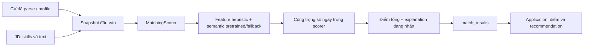
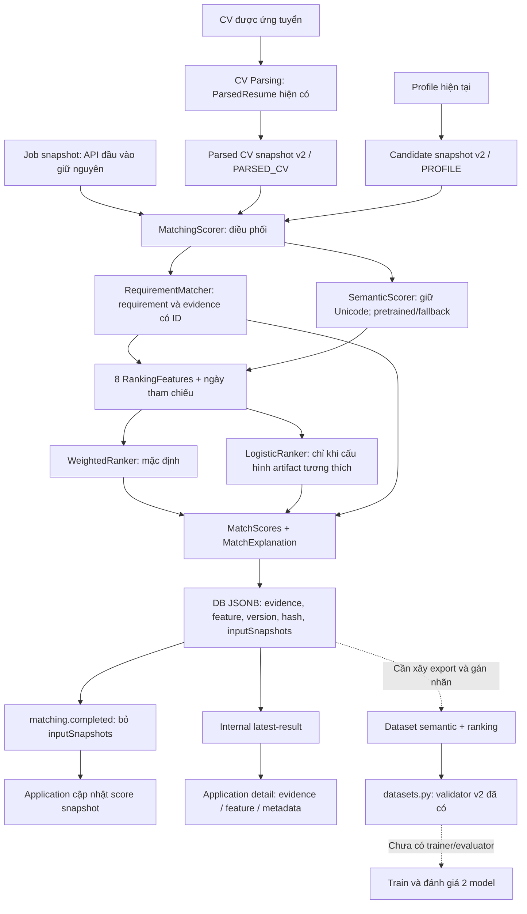

# Bản đồ thay đổi: develop → chuẩn bị dataset/model

Ngày chụp ngữ cảnh: 08/10/2026. Bản cũ là commit `fa0bb59` trên `develop`.
Bản hiện tại là worktree của `feat/matching-model-readiness`; chưa commit/push.
Trước khi thêm bản đồ này có 34 file thay đổi: 26 file sửa và 8 file mới.
`git diff` không hiển thị nội dung các file mới chưa được Git theo dõi.

## 1. Đọc trong 5 phút

Đọc sơ đồ ở mục 2, bảng trước/sau ở mục 3 và trạng thái ở mục 7 trước. Sau đó
chỉ mở nhóm file liên quan ở mục 4. Không cần đọc toàn bộ diff cùng lúc.

Mục tiêu của các thay đổi là giữ đủ evidence CV/JD, làm rõ semantic và ranking,
và lưu dữ liệu có thể truy lại khi gán nhãn. Hệ thống hiện vẫn dùng pretrained
embedding hoặc lexical fallback và ranking trọng số mặc định. Chưa train model.

Nhớ vai trò của 5 file nên đọc để hiểu luồng:

| File | Câu hỏi mà file trả lời |
| --- | --- |
| `snapshots.py` | Matching nhận dữ liệu CV/profile/JD như thế nào? |
| `scorer.py` | Từ đầu vào, tính feature và phối hợp các bộ chấm điểm ra sao? |
| `ranking.py` | Từ 8 feature, tính điểm tổng bằng baseline/model nào? |
| `match_result.py` | Kết quả gồm điểm, evidence và metadata gì? |
| `datasets.py` | Một dòng dataset có nhãn phải đáp ứng chuẩn gì? |

`datasets.py` chạy offline, không nằm trong luồng chấm application hiện tại.
`READINESS_REVIEW.md` là bản rà soát lịch sử trước v2, không phải hợp đồng hiện hành.
[matching-data-contract.md](matching-data-contract.md) là tài liệu chuẩn hiện tại.

## 2. Sơ đồ trước và sau

### Bản cũ



Bản cũ đã có RequirementMatcher và một số evidence logic. Các thay đổi hiện tại
mở rộng và đưa evidence ra kết quả; không phải tạo toàn bộ matching từ đầu.

### Bản hiện tại



Mũi tên nét đứt là công việc còn thiếu, không phải pipeline đang tự động chạy.
Snapshot PROFILE và PARSED_CV dùng cùng cấu trúc, nhưng không đảm bảo cùng nội dung:
profile có thể đã được sửa, còn application dùng CV cụ thể đã nộp.

## 3. Điều gì thực sự đổi hành vi?

| Chủ đề | Bản cũ | Bản hiện tại | Hệ quả |
| --- | --- | --- | --- |
| Experience | Chỉ title/company và thời gian | Giữ thêm description và ID | Semantic/evidence thấy nội dung công việc |
| Project từ profile | Chỉ tên | Object có description/technologies/ID | Hai nguồn đầu vào không còn khác shape ở project |
| Certification | String tên | Object có issuer/description/năm/ID | Evidence đầy đủ hơn; feature chứng chỉ vẫn 0 |
| Văn bản semantic | Bỏ dấu theo ASCII | NFKC, lowercase, giữ Unicode | Dataset và inference cần cùng preprocessing v2 |
| Tách requirement | Tách mọi dấu chấm, giới hạn độ dài và 16 mục | Giữ Node.js, không cắt các mục như trước | JD có thể tạo nhiều requirement hơn |
| Kinh nghiệm | Cộng thời gian từng job | Gộp khoảng chồng lấn, cố định ngày tham chiếu | Điểm experience/level có thể thay đổi |
| Ranking | Cộng trọng số trong scorer | Ranker riêng, default trọng số như cũ | Có điểm nối cho model đã train sau này |
| Explanation | Nhãn matched/missing và lời khuyên | Thêm evidence/source/ID/method/score | Có thể kiểm tra và gán nhãn theo requirement |
| Lưu đầu vào | Không giữ đủ input cho replay trong result | Lưu job/candidate snapshot và hash | Profile/JD đổi sau này không mất đầu vào đã chấm |
| Application detail | Chỉ explanation cũ | Thêm evidence, feature, metadata | FE có payload mới để hiển thị |
| Dataset | Không có contract/validator mới | JSONL v2, version/hash/label/split rules | Chuẩn hóa trước training, chưa tạo dataset thật |

Vì đầu vào và cách trích feature đổi, điểm mới không nhất thiết bằng điểm cũ,
dù WeightedRanker giữ cùng trọng số. v1 không được đổi tên thành v2 mà giữ nguyên
feature. Cần tính lại nếu muốn so sánh/train bằng hợp đồng mới.

## 4. Bản đồ toàn bộ file đã thay đổi

Mỗi file trước lượt này xuất hiện đúng một lần trong các nhóm dưới đây. “Mới” là
file đã tạo trong workspace nhưng chưa được Git theo dõi tại thời điểm rà soát.

### A. Hợp đồng dữ liệu: 5 file

| File | Vai trò thay đổi |
| --- | --- |
| [snapshots.py](../apps/matching-service/app/schemas/snapshots.py) | Python đọc snapshot v2; giữ description/ID, certification object; đọc được string arrays cũ |
| [match_result.py](../apps/matching-service/app/schemas/match_result.py) | Schema evidence, inputSnapshots, features và metadata trong explanation |
| [matching-snapshot.interface.ts](../packages/shared/src/interfaces/matching-snapshot.interface.ts) — Mới | Hợp đồng snapshot dùng chung ở TypeScript |
| [match-result-payload.interface.ts](../packages/shared/src/interfaces/match-result-payload.interface.ts) | Kiểu TS cho evidence/features/model metadata, mở rộng explanation |
| [index.ts](../packages/shared/src/index.ts) | Export hợp đồng snapshot mới |

### B. Matching runtime: 7 file

| File | Vai trò thay đổi |
| --- | --- |
| [normalizer.py](../apps/matching-service/app/matching/normalizer.py) | Thêm preprocessing semantic Unicode và version |
| [semantic.py](../apps/matching-service/app/matching/semantic.py) | Dùng text mới, thêm mô tả experience/education/certification vào semantic input |
| [requirement_matcher.py](../apps/matching-service/app/matching/requirement_matcher.py) | Giữ text nguồn/ID; đổi phrase splitting; xuất method và pair signal |
| [scorer.py](../apps/matching-service/app/matching/scorer.py) | Phối hợp feature/ranker, gộp experience intervals, lưu metadata/hash/inputSnapshots |
| [ranking.py](../apps/matching-service/app/matching/ranking.py) — Mới | Feature contract, WeightedRanker, Logistic JSON inference và artifact validation |
| [service.py](../apps/matching-service/app/matching/service.py) | Mapping parsed CV đầy đủ; serialize JSON; event bỏ full inputSnapshots |
| [config.py](../apps/matching-service/app/config.py) | Thêm optional ranking artifact path |

### C. Candidate producer: 2 file

| File | Vai trò thay đổi |
| --- | --- |
| [candidate.service.ts](../apps/candidate-service/src/candidate/candidate.service.ts) | Emit profile snapshot v2 đầy đủ evidence, ID và dataOrigin |
| [candidate-application-snapshot.dto.ts](../apps/candidate-service/src/candidate/dto/candidate-application-snapshot.dto.ts) | Swagger/DTO cho description và certification/project objects |

### D. Application consumer: 4 file

| File | Vai trò thay đổi |
| --- | --- |
| [application-internal-client.service.ts](../apps/application-service/src/application/application-internal-client.service.ts) | Dùng shared snapshot/explanation types thay cho bản khai báo riêng thiếu field |
| [application.service.ts](../apps/application-service/src/application/application.service.ts) | Map evidence/features/metadata mới vào response |
| [application-response.dto.ts](../apps/application-service/src/application/dto/application-response.dto.ts) | Khai báo 3 trường response mới và Swagger evidence |
| [application-input.dto.ts](../apps/application-service/src/application/dto/application-input.dto.ts) | Sửa mô tả parse theo hành vi code; không thay đổi chính sách auto-match |

### E. Dataset offline: 2 file

| File | Vai trò thay đổi |
| --- | --- |
| [datasets.py](../apps/matching-service/ml/datasets.py) — Mới | SemanticRecord/RankingRecord, kiểm tra nhãn/version/hash/split/leakage và CLI |
| [__init__.py](../apps/matching-service/ml/__init__.py) — Mới | Cho phép chạy package ml bằng Python module |

Validator không lấy dữ liệu từ DB, không gán nhãn, không tự chia tập và không train.
Nó kiểm tra JSONL bạn hoặc pipeline export tương lai cung cấp.

### F. Test: 3 file

| File | Vai trò thay đổi |
| --- | --- |
| [test_model_readiness.py](../apps/matching-service/tests/test_model_readiness.py) — Mới | Artifact/features/dataset contracts, Unicode, replay và event snapshot filtering |
| [candidate.service.spec.ts](../apps/candidate-service/src/candidate/test/candidate.service.spec.ts) | Kiểm tra producer giữ evidence trong snapshot v2 |
| [application.service.spec.ts](../apps/application-service/src/application/test/application.service.spec.ts) | Kiểm tra response expose evidence/features/metadata |

### G. Tài liệu: 9 file

| File | Nên đọc khi nào? |
| --- | --- |
| [api-docs README](README.md) | Tra chỉ mục docs |
| [candidate-service.md](candidate-service.md) | Kiểm tra internal snapshot đổi từ string arrays sang objects |
| [application-service.md](application-service.md) | FE response mới, null behavior và parse flag |
| [matching-service.md](matching-service.md) | Matching endpoints và thay đổi runtime |
| [cv-parsing-service.md](cv-parsing-service.md) | ParsedResume không đổi; matching downstream đã giữ thêm dữ liệu |
| [job-service.md](job-service.md) | API Job không đổi; phân biệt regex extraction với structured JD parser |
| [matching-data-contract.md](matching-data-contract.md) — Mới | Hợp đồng v2 hiện hành, chuẩn dataset và migration notes |
| [ml README](../apps/matching-service/ml/README.md) — Mới | Cách chạy validator, artifact format và training work còn thiếu |
| [READINESS_REVIEW.md](../apps/matching-service/ml/READINESS_REVIEW.md) — Mới | Bối cảnh rà soát trước v2; một số thiếu hụt đã được xử lý |

### H. Config: 2 file

| File | Vai trò thay đổi |
| --- | --- |
| [.env.example](../.env.example) | Ghi nhận MATCHING_RANKING_ARTIFACT_PATH optional; env thật không bị sửa |
| [.gitignore](../.gitignore) | Không đưa raw dataset/model artifacts trong ml/data và ml/artifacts vào Git |

## 5. Theo dõi một application cụ thể

1. Candidate nộp CV. Application service tiếp tục yêu cầu auto-match như bản cũ.
2. Có parsed CV thì dùng ngay; chưa có thì request parsing và đợi CV parsed.
3. Matching lấy JD snapshot và chuyển parsed CV thành candidate snapshot v2.
4. RequirementMatcher tìm evidence; SemanticScorer tính tín hiệu text.
5. Scorer tính 8 feature, đưa chúng cho WeightedRanker mặc định.
6. Match result lưu điểm và explanation chứa inputs, evidence, metadata.
7. Event cập nhật score snapshot của Application; event không chứa inputSnapshots.
8. Khi lấy application detail có enrichment, Application gọi internal latest-result
   rồi trả matchRequirementMatches, matchRankingFeatures và matchModelMetadata.

Các field mới có thể null ở list response hoặc result cũ. Không suy ra lỗi chỉ
vì list có matchScore nhưng chưa có evidence. Full inputSnapshots chỉ nằm ở
matching DB/internal result API, không được đưa nguyên vào public Application DTO.

## 6. Không nhầm các loại version và score

| Tên | Ý nghĩa |
| --- | --- |
| candidate-matching-v2 | Hình dạng input snapshot |
| candidate-job-v2 | Hợp đồng 8 feature |
| heuristic-features-v2 | Cách tính feature hiện tại |
| matching-text-v2 | Cách xử lý text |
| matching-dataset-v2 | Hợp đồng dòng dataset có nhãn |
| weighted-baseline-v1 | Tên bộ ranking trọng số; v1 ở đây không phải feature v1 |
| semanticModelVersion | Tên/đường dẫn pretrained, semantic-disabled hoặc lexical-fallback hiện tại |

comparisonScore là tín hiệu cặp text/rule trước source weighting. score trong
requirementMatches là business score sau threshold/weight. totalScore là kết quả
ranker. Không loại nào được mặc định xem là xác suất tuyển dụng hoặc nhãn train.

## 7. Ranh giới hiện tại

| Trạng thái | Nội dung |
| --- | --- |
| Đã chạy bằng code | Snapshot v2, evidence, Unicode preprocessing, 8 feature, weighted ranking, lưu/replay input, detail response mới, dataset validator |
| Có bộ inference, chưa có model đã train | LogisticRanker và nạp SentenceTransformer directory |
| Chưa triển khai | Structured JD parser, JD-specific certification/education/experience, feedback/export pipeline, dataset builder/splitter/miner, trainer/evaluator, XGBoost/LTR adapter, frontend evidence, Top-K recommendation |
| Chưa kiểm chứng vận hành | Model thật, DB/RabbitMQ E2E, load/latency và model artifact promotion |

Certification feature vẫn 0; education/experience còn heuristic chung. Những giới
hạn này được ghi vào featureLimitations. Semantic model identity còn dựa vào
tên/path, chưa có immutable weight manifest/checksum.

Kết quả kiểm chứng ở lượt code trước: 38 Python tests, 38 Candidate/Application
tests, TypeScript noEmit và git diff --check pass. Lượt tạo bản đồ này chỉ sửa
tài liệu, không chạy lại test hoặc thay đổi logic.

## 8. Phương pháp theo dõi từ đây

Mỗi đợt thay đổi mới ghi 4 điều: luồng nào đổi, contract/version nào đổi, file nào
chịu trách nhiệm và test nào chứng minh. Cập nhật bản đồ này khi ranh giới runtime,
dataset hoặc training đổi; thông số/field chi tiết vẫn đặt trong data contract.

Muốn xem một nhóm code trong IDE, mở Source Control và chọn các file của nhóm đó.
Muốn xem bằng terminal, dùng các lệnh đọc sau ở repository root:

```powershell
git status --short
git diff develop -- apps/matching-service/app
git diff develop -- apps/candidate-service/src/candidate
git diff develop -- apps/application-service/src/application
git ls-files --others --exclude-standard
```

Lệnh diff chỉ bao gồm file đã được theo dõi. Các file mới như ranking.py và
datasets.py cần mở trực tiếp cho đến khi được stage. Không cần stage/commit chỉ
để hiểu thay đổi; chưa có commit riêng cho từng giai đoạn ở branch hiện tại.
