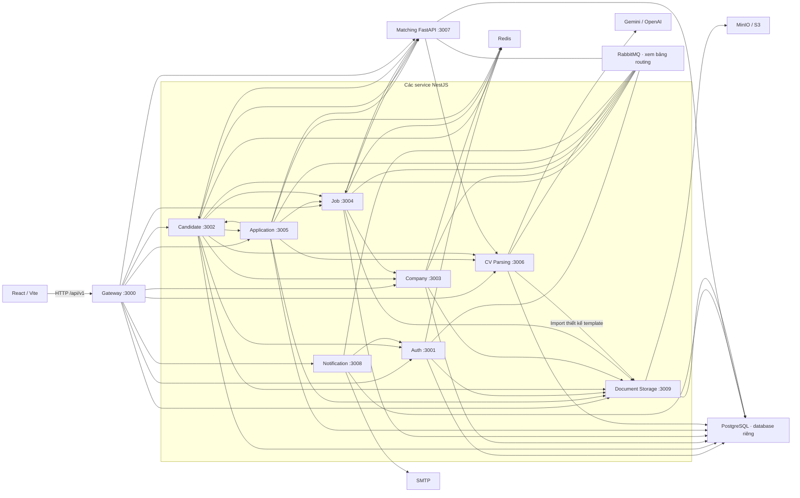
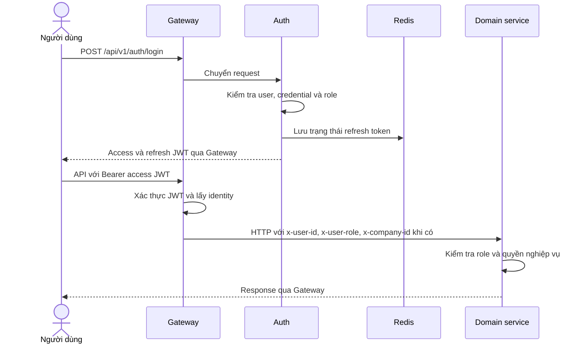
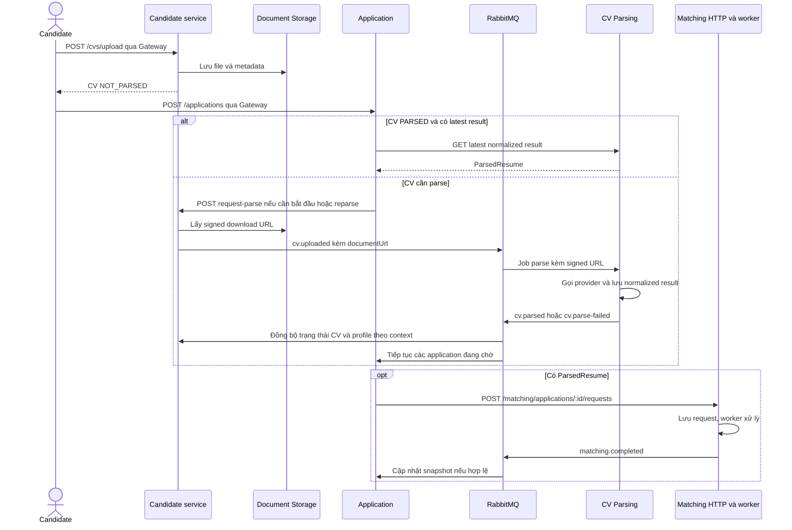
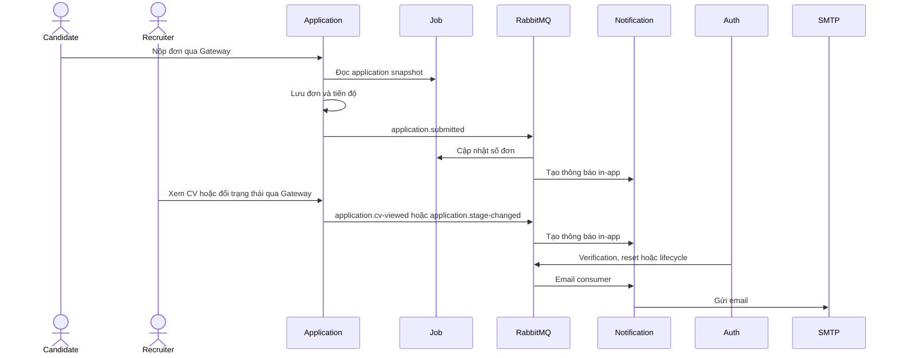

# Bản đồ dự án NexHire

## 1. Tổng quan

**[ĐÃ XÁC NHẬN TRONG CODE]** NexHire gồm cổng tìm việc và hệ thống quản lý tuyển dụng. Backend có 10 tiến trình logic gồm Gateway và 9 service nghiệp vụ. Nest CLI khai báo 10 application và hai library, nhưng đường chạy matching mặc định khởi động FastAPI bằng Uvicorn. Các đường dẫn BE bên dưới tính từ gốc repo. Đường dẫn `../Nexthire-FE/` và `../CHUONG_5_PIPELINE_AI.md` tham chiếu workspace cùng cấp. Nguồn `README.md`, `package.json`, `nest-cli.json`, `scripts/matching-service.js`.

| Thư mục | Nội dung đã đối chiếu |
| --- | --- |
| `apps/<service>/src` | Bootstrap, module, controller, DTO, service, entity, config và test NestJS theo từng service. Nguồn `nest-cli.json`, `apps/gateway/src/main.ts`, `apps/application-service/src/application-service.module.ts`. |
| `apps/matching-service/{app,migrations,ml,tests,src}` | Runtime Python, SQL matching, mã huấn luyện/đánh giá, test và cây NestJS còn tồn tại. Nguồn `apps/matching-service/README.md`, `apps/matching-service/app/main.py`. |
| `packages/{shared,infra}/src` | Alias TypeScript. Shared chứa DTO, guards, enums, event/snapshot contract. Infra chứa TypeORM, Redis, S3 và publisher AMQP. Nguồn `tsconfig.json`, `packages/shared/src/index.ts`, `packages/infra/src/index.ts`. |
| `scripts/`, `test/test-flows/`, `api-docs/`, `docs/hand-off/`, `development-rules/` | Script bootstrap, migration, seed, kịch bản tích hợp, API contract, handoff và quy ước đóng góp. Nguồn `package.json`, `test/test-flows/README.md`, `api-docs/README.md`, `docs/hand-off/README.md`, `development-rules/README.md`. |

**[ĐÃ XÁC NHẬN TRONG CODE]** Sơ đồ dùng mũi tên HTTP chính và các nhóm kết nối hạ tầng. PostgreSQL trong Compose dùng một instance với database riêng cho từng service lưu dữ liệu. Nguồn `apps/gateway/src/proxy/proxy.controller.ts`, `apps/application-service/src/application/application-internal-client.service.ts`, `apps/matching-service/app/clients/internal.py`, `scripts/init-databases.sql`, `docker-compose.yml`, `packages/infra/src/storage/storage.service.ts`, `apps/notification-service/src/notification-service.module.ts`.

## 2. Từng service

**[ĐÃ XÁC NHẬN TRONG CODE]** Port là mặc định local. Cột DB ghi theo dạng `database.schema`. Event ghi gọn theo nhóm, bảng ở mục 3.4 liệt kê routing key và binding cụ thể. Nguồn cấu hình chung `.env.example`, `scripts/init-databases.sql`.

| Service | Trách nhiệm | Port | DB schema | Publish / consume | Nguồn |
| --- | --- | ---: | --- | --- | --- |
| Gateway | Proxy, JWT, rate limit, Swagger, dashboard tổng hợp | 3000 | — | — | `apps/gateway/src/gateway.module.ts`, `apps/gateway/src/config/gateway.config.ts` |
| Auth | Tài khoản, xác thực, recruiter-company link, quản trị user | 3001 | `auth_service_db.public` | Auth email/reset và lifecycle / company và candidate snapshots | `apps/auth-service/src/auth-service.module.ts`, `apps/auth-service/src/auth/auth.module.ts`, `apps/auth-service/src/admin-user/events/admin-user-event.publisher.ts` |
| Candidate | Profile, CV, template, lưu job, theo dõi công ty, chuẩn bị/gợi ý việc làm | 3002 | `candidate_service_db.public` | `cv.uploaded`, candidate snapshot, followed job / kết quả parse, job publish | `apps/candidate-service/src/candidate-service.module.ts`, `apps/candidate-service/src/cv/events/cv-event.publisher.ts`, `apps/candidate-service/src/followed-company/followed-company.module.ts` |
| Company | Hồ sơ doanh nghiệp, xác minh giấy tờ, trust, tenant | 3003 | `company_service_db.public` | Company snapshot và review request / job review trust signal | `apps/company-service/src/company-service.module.ts`, `apps/company-service/src/company/events/company-event.publisher.ts`, `apps/company-service/src/company/events/consumers/job-review-trust-signal.consumer.ts` |
| Job | Job, revision, moderation, category, skill dictionary và JD plan | 3004 | `job_service_db.public` | Job lifecycle, review, revision và trust / company snapshot, application submitted | `apps/job-service/src/job-service.module.ts`, `apps/job-service/src/job/events/job-event.publisher.ts`, `apps/job-service/src/job/job.module.ts` |
| Application | Nộp đơn, ATS, vòng tuyển dụng, snapshot, điều phối parse/match và workspace review | 3005 | `application_service_db.public` | Submitted/stage/CV viewed / job lifecycle, candidate snapshot, parse/matching result | `apps/application-service/src/application-service.module.ts`, `apps/application-service/src/application/application.module.ts`, `apps/application-service/src/application/events/application-event.publisher.ts` |
| CV Parsing | Parse CV, cấu hình AI và import thiết kế template | 3006 | `cv_parsing_service_db.public` | `cv.parsed`, `cv.parse-failed` / `cv.uploaded` | `apps/cv-parsing-service/src/cv-parsing-service.module.ts`, `apps/cv-parsing-service/src/cv-parsing/cv-parsing.module.ts` |
| Matching | Hàng đợi DB, evidence AI1, JD plan, gợi ý và AI2 demo | 3007 | `matching_service_db.public` | `matching.completed` / nhận match request qua HTTP | `apps/matching-service/app/main.py`, `apps/matching-service/app/worker.py`, `apps/matching-service/app/publishers/events.py` |
| Notification | In-app, SMTP, monitor queue và cảnh báo Telegram | 3008 | `notification_service_db.public` | — / auth, lifecycle, application, company và job review | `apps/notification-service/src/notification-service.module.ts`, `apps/notification-service/src/in-app/notification-events.consumer.ts`, `apps/notification-service/src/email/email-events.consumer.ts` |
| Document Storage | Upload, metadata, signed download và xóa object | 3009 | `document_storage_service_db.public` | — | `apps/document-storage-service/src/document-storage-service.module.ts`, `apps/document-storage-service/src/document/document.service.ts` |

### Gateway

- **[ĐÃ XÁC NHẬN TRONG CODE]** `ProxyModule` chuyển tiếp theo nhóm path `auth`, `candidates`, `cvs`, templates, companies, jobs, applications, notifications, documents và các nhóm admin/recruiter. Dashboard có controller riêng và DTO tổng hợp. Gateway định nghĩa prefix `/api/v1`, CORS theo frontend URL, Swagger `/api/docs`, health `/api/v1/health`, rate limit toàn cục cùng quy tắc auth. Nguồn `apps/gateway/src/main.ts`, `apps/gateway/src/proxy/proxy.controller.ts`, `apps/gateway/src/admin-dashboard/admin-dashboard.dto.ts`, `apps/gateway/src/recruiter-dashboard/recruiter-dashboard.controller.ts`, `apps/gateway/src/gateway.module.ts`, `apps/gateway/src/rate-limit/auth-rate-limit.ts`.
- **[ĐÃ XÁC NHẬN TRONG CODE]** Config riêng quản lý port, URL downstream, JWT access secret và Swagger/timeout. Gateway không đăng ký TypeORM/Redis/EventBus trong module. Nguồn `apps/gateway/src/config/gateway.config.ts`, `apps/gateway/src/config/env.validation.ts`, `apps/gateway/src/gateway.module.ts`, `apps/gateway/src/proxy/proxy.service.ts`.

### Auth

- **[ĐÃ XÁC NHẬN TRONG CODE]** `AuthModule`, `AdminUserModule`, `PermissionModule` và token service hỗ trợ `POST /auth/{register,login,google/login,refresh,logout,verify-email,resend-verification,forgot-password,reset-password,change-password}`, `GET/PATCH /auth/me`, avatar và `/admin/users` cho vòng đời user. Nội bộ có contact snapshot và danh sách admin nhận thông báo. DTO tiêu biểu `RegisterDto`, `LoginDto`, `RefreshTokenDto`; controller token/permission hiện chỉ khai báo prefix. Nguồn `apps/auth-service/src/auth/auth.controller.ts`, `apps/auth-service/src/admin-user/admin-user.controller.ts`, `apps/auth-service/src/auth/dto/`, `apps/auth-service/src/token/token.controller.ts`, `apps/auth-service/src/permission/permission.controller.ts`.
- **[ĐÃ XÁC NHẬN TRONG CODE]** `users` liên kết credential 1:1 và identities, role mappings, email verifications, password-reset tokens 1:N; có `roles` và `recruiter_company_links`. Bcrypt và Redis phục vụ credential/token, tài liệu avatar qua storage. `AUTH_SERVICE_DB_*`, JWT, Google và OTP được cấu hình riêng. Migration có Google identities, single user role, avatar/language và recruiter links; seed role/admin. Nguồn `apps/auth-service/src/auth/entities/`, `apps/auth-service/src/auth/auth.service.ts`, `apps/auth-service/src/auth/document-client.service.ts`, `apps/auth-service/src/token/token.service.ts`, `apps/auth-service/src/config/`, `apps/auth-service/data-source.ts`, `apps/auth-service/src/migrations/`, `apps/auth-service/src/seeds/`.

### Candidate

- **[ĐÃ XÁC NHẬN TRONG CODE]** Candidate, CV, template/preset, saved job và followed company là các module chính. API gồm `GET/PATCH /candidates/me`, avatar, `POST /cvs/upload`, `POST /cvs/:id/parse`, `POST /cvs/:id/parse-for-recommendations`, `DELETE /cvs/:id`, `/cv-templates`, `/cv-template-presets`, `/admin/cv-template-presets`, `/saved-jobs`, `/followed-companies`, preparation và job recommendations theo CV. Nội bộ có apply parse result/failure và application/matching snapshot. DTO tiêu biểu `UploadCvDto`, `RequestCvParseDto`, `UpdateCandidateProfileDto`, `CandidateApplicationSnapshotDto`. Nguồn `apps/candidate-service/src/candidate-service.module.ts`, `apps/candidate-service/src/candidate/`, `apps/candidate-service/src/cv/`, `apps/candidate-service/src/cv-template/cv-template.controller.ts`, `apps/candidate-service/src/cv-template-preset/`, `apps/candidate-service/src/saved-job/saved-job.controller.ts`, `apps/candidate-service/src/followed-company/followed-company.controller.ts`.
- **[ĐÃ XÁC NHẬN TRONG CODE]** `candidate_profiles` sở hữu skills, educations, experiences, projects, certifications, CV, templates, saved jobs và followed companies. Preset nằm trong `cv_template_presets`. Service dùng Document Storage và Redis-cache download URL, HTTP client cho Auth, Job, Company, Application và CV Parsing. CV cleanup hỏi Application về document retention. Migration bổ sung soft delete, locale, canvas và presets. Nguồn `apps/candidate-service/src/candidate/entities/`, `apps/candidate-service/src/cv-template/entities/`, `apps/candidate-service/src/cv-template-preset/entities/`, `apps/candidate-service/src/saved-job/`, `apps/candidate-service/src/followed-company/`, `apps/candidate-service/src/document-client/document-client.service.ts`, `apps/candidate-service/src/cv/cv.service.ts`, `apps/candidate-service/src/config/`, `apps/candidate-service/data-source.ts`, `apps/candidate-service/src/migrations/`.

### Company

- **[ĐÃ XÁC NHẬN TRONG CODE]** Company và HR Account modules. API có `POST /companies`, `GET /companies/me`, public detail, cập nhật logo/hero, tải và yêu cầu duyệt giấy tờ. Admin có list/overview/growth, verify, suspend/restore và trust history. Nội bộ cấp `GET /internal/companies/:id/posting-snapshot`. DTO nằm cùng module company. `HrAccountService` hiện rỗng. Nguồn `apps/company-service/src/company-service.module.ts`, `apps/company-service/src/company/company.controller.ts`, `apps/company-service/src/company/dto/`, `apps/company-service/src/hr-account/hr-account.service.ts`.
- **[ĐÃ XÁC NHẬN TRONG CODE]** `companies`, `company_verification_documents`, `company_trust_histories`, `company_processed_trust_signals` lưu hồ sơ, liên kết giấy tờ bằng ID, lịch sử trust và dấu xử lý event. Giấy tờ/logo qua Document Storage, Redis cache signed URL. Migration bổ sung trust, public/contact và tracking verification. Nguồn `apps/company-service/src/company/entities/`, `apps/company-service/src/document-client/document-client.service.ts`, `apps/company-service/src/config/`, `apps/company-service/data-source.ts`, `apps/company-service/src/migrations/`.

### Job

- **[ĐÃ XÁC NHẬN TRONG CODE]** Job, Category, SkillDictionary và JD Requirement Plan. Public `/jobs`, `/jobs/:id`, company jobs, featured companies, home stats và `/categories`. Recruiter tạo, submit, sửa bằng revisions, unpublish/republish/close. Admin duyệt job/revision, quản lý moderation policies và skill dictionary. Recruiter có `/recruiter/jobs/:id/requirement-plan` cho đọc/history/draft/edit/confirm; internal cấp job snapshots, recommendation pool và plan. Nguồn `apps/job-service/src/job-service.module.ts`, `apps/job-service/src/job/controllers/`, `apps/job-service/src/job/dto/`, `apps/job-service/src/category/category.controller.ts`, `apps/job-service/src/skill-dictionary/skill-dictionary.controller.ts`, `apps/job-service/src/skill-dictionary/dto/skill-dictionary.dto.ts`, `apps/job-service/src/job/requirement-plan/requirement-plan.controller.ts`, `apps/job-service/src/job/requirement-plan/requirement-plan.dto.ts`.
- **[ĐÃ XÁC NHẬN TRONG CODE]** DB gồm jobs, job revisions, moderation reviews/policies, categories, company posting snapshots, processed application events, requirement plans/events và dictionary skills/names/audit. Revisions và plans tham chiếu job nội DB. Job đọc snapshot Company, dùng Redis cache public/category/signed URL, gọi Matching để dựng/kiểm tra plan. Nguồn `apps/job-service/src/job/entities/`, `apps/job-service/src/category/entities/job-category.entity.ts`, `apps/job-service/src/skill-dictionary/entities/dictionary-skill.entity.ts`, `apps/job-service/src/job/company/company-snapshot.service.ts`, `apps/job-service/src/job/job.service.ts`, `apps/job-service/src/category/category.service.ts`, `apps/job-service/src/job/requirement-plan/`, `apps/job-service/src/config/`, `apps/job-service/data-source.ts`, `apps/job-service/src/migrations/`.

### Application

- **[ĐÃ XÁC NHẬN TRONG CODE]** `POST /applications`, `GET /applications/me[/:id]`, `GET /applications/me/:id/cv`; recruiter dùng `/recruiter/applications` cho danh sách, stats, CV, review workspace, HR review, matching status, AI2 và thay đổi trạng thái. `/recruiter/candidates` lấy danh sách/chi tiết ứng viên theo ứng tuyển. Nội bộ có CV retention và match snapshot. DTO ở `application-input.dto.ts`, `application-query.dto.ts`, `application-response.dto.ts`, `review-workspace.dto.ts`. Nguồn `apps/application-service/src/application/application.controller.ts`, `apps/application-service/src/application/recruiter-application.controller.ts`, `apps/application-service/src/application/recruiter-candidate.controller.ts`, `apps/application-service/src/application/dto/`.
- **[ĐÃ XÁC NHẬN TRONG CODE]** `applications` giữ snapshot job/công ty/candidate/file, `application_progress_events` có unique theo application/step và `application_reviews` tham chiếu application. HTTP client gọi Job, Candidate, CV Parsing, Matching và Document Storage, dùng Redis để cache signed URL. Migration có unique một đơn active/candidate/job, progress, auto match và review. Nguồn `apps/application-service/src/application/entities/`, `apps/application-service/src/application/application-internal-client.service.ts`, `apps/application-service/src/application/review-workspace.service.ts`, `apps/application-service/src/config/`, `apps/application-service/data-source.ts`, `apps/application-service/src/migrations/`.

### CV Parsing

- **[ĐÃ XÁC NHẬN TRONG CODE]** CvParsing, Gemini/OpenAI, AiManagement và TemplateDesign. API nội bộ `POST /internal/cv-parsing/{parse,template-fill}`, đọc latest result theo CV, hoàn tất request theo ID. Manual controller có parse-file. Admin quản lý AI config/usage qua `/admin/ai-configs`, import/đọc template design job qua `/admin/cv-template-designs`. DTO request/completion/result tách riêng. Nguồn `apps/cv-parsing-service/src/cv-parsing-service.module.ts`, `apps/cv-parsing-service/src/cv-parsing/cv-parsing.controller.ts`, `apps/cv-parsing-service/src/cv-parsing/manual/manual-cv-parsing.controller.ts`, `apps/cv-parsing-service/src/cv-parsing/dto/`, `apps/cv-parsing-service/src/ai-management/ai-management.controller.ts`, `apps/cv-parsing-service/src/template-design/admin-template-design.controller.ts`.
- **[ĐÃ XÁC NHẬN TRONG CODE]** Parse requests/results liên kết 1:1, `ai_system_configs`, `ai_usage_logs` và `cv_template_design_jobs` lưu cấu hình runtime, token usage và công việc dựng canvas. Đọc file qua signed URL Document Storage, chọn Gemini/OpenAI theo config runtime, log usage và có tùy chọn giữ raw provider payload. Giá trị model fallback trong code là `gemini-3.5-flash` và `gpt-5.5`, có thể override bằng env/config AI. Template design có đường PDF canvas extractor và OpenAI client. Nguồn `apps/cv-parsing-service/src/cv-parsing/cv-parsing.service.ts`, `apps/cv-parsing-service/src/cv-parsing/entities/`, `apps/cv-parsing-service/src/ai-management/entities/`, `apps/cv-parsing-service/src/template-design/template-design.service.ts`, `apps/cv-parsing-service/src/template-design/entities/cv-template-design-job.entity.ts`, `apps/cv-parsing-service/src/config/`, `apps/cv-parsing-service/data-source.ts`, `apps/cv-parsing-service/src/migrations/`.

### Matching

- **[ĐÃ XÁC NHẬN TRONG CODE]** FastAPI routes `/matching/applications/:id/requests`, `latest-result`, `latest-hr-review`, `latest-ai2-demo`, `/matching/jobs/:id/ai2-demo-pool`. Tách router internal JD plans, candidate preparation, job recommendations và health. Pydantic contract nằm trong `app/schemas/`; SQLAlchemy lưu `match_requests`, `match_results`; SQL004 thêm `job_recommendation_embeddings`. Job, Candidate và CV Parsing cấp snapshot/source qua HTTP. Nguồn `apps/matching-service/app/api/`, `apps/matching-service/app/recommendations/api.py`, `apps/matching-service/app/schemas/`, `apps/matching-service/app/models/matching.py`, `apps/matching-service/app/config.py`, `apps/matching-service/app/clients/internal.py`, `apps/matching-service/migrations/`.
- **[ĐÃ XÁC NHẬN TRONG CODE]** Cây NestJS giữ entity và DataSource TypeORM. Runtime thông thường và Dockerfile service dùng Python. Phân biệt hai đường migration ở mục 6. Nguồn `apps/matching-service/src/matching-service.module.ts`, `apps/matching-service/data-source.ts`, `apps/matching-service/Dockerfile`, `package.json`.

### Notification

- **[ĐÃ XÁC NHẬN TRONG CODE]** Mailer, Email, Notification, QueueMonitor và WebPush modules. `GET /notifications`, `GET /notifications/unread-count`, `PATCH /notifications/read-all`, `PATCH /notifications/:id/read` theo user. DTO query/response và entity `notifications` nằm trong in-app; migration quản lý bảng và các loại event. Tra cứu người nhận admin qua Auth, nhận SMTP và Telegram monitor config riêng. Email/WebPush controllers hiện chỉ có prefix; WebPush service rỗng. Nguồn `apps/notification-service/src/notification-service.module.ts`, `apps/notification-service/src/in-app/`, `apps/notification-service/src/email/email.controller.ts`, `apps/notification-service/src/web-push/`, `apps/notification-service/src/queue-monitor/queue-monitor.service.ts`, `apps/notification-service/src/config/`, `apps/notification-service/data-source.ts`, `apps/notification-service/src/migrations/`.

### Document Storage

- **[ĐÃ XÁC NHẬN TRONG CODE]** Document, Health, TypeORM và Storage modules. `POST /documents/upload` nhận multipart cùng DTO owner/type. Nội bộ có `GET /internal/documents/:id/{metadata,download-url}` và `DELETE /internal/documents/:id`. `documents` giữ metadata, owner và object key. S3 adapter dùng signed URL và có thể tạo bucket; cấu hình ưu tiên `STORAGE_*`, fallback `MINIO_*`. Nguồn `apps/document-storage-service/src/document-storage-service.module.ts`, `apps/document-storage-service/src/document/document.controller.ts`, `apps/document-storage-service/src/document/document.service.ts`, `apps/document-storage-service/src/document/dto/`, `apps/document-storage-service/src/document/entities/document.entity.ts`, `apps/document-storage-service/src/config/`, `apps/document-storage-service/data-source.ts`, `apps/document-storage-service/src/migrations/`, `packages/infra/src/config/infra.config.ts`, `packages/infra/src/storage/storage.service.ts`.

## 3. Luồng xuyên service

### 3.1 Xác thực và phân quyền

**[ĐÃ XÁC NHẬN TRONG CODE]** Auth cấp access/refresh JWT bằng hai secret; Redis lưu refresh theo user/jti và token version, phục vụ rotation và thu hồi. Gateway dùng Passport JWT để kiểm access signature/hạn và suy ra user ID, role, company ID, rồi dựng header nội bộ từ identity đã xác thực. Guard JWT tại Gateway là optional cho proxy. Domain service kiểm tra identity và role theo endpoint; các endpoint service-to-service có token riêng khi gắn `InternalServiceTokenGuard`. FastAPI kiểm `x-internal-service-token` bằng dependency riêng. Gateway proxy chỉ chuyển tiếp các header được dựng trong code. Nguồn `apps/auth-service/src/auth/auth.service.ts`, `apps/auth-service/src/token/token.service.ts`, `apps/gateway/src/strategies/jwt.strategy.ts`, `apps/gateway/src/guards/optional-jwt.guard.ts`, `apps/gateway/src/proxy/proxy.service.ts`, `packages/shared/src/guards/internal-auth.guard.ts`, `packages/shared/src/guards/internal-service-token.guard.ts`, `packages/shared/src/guards/roles.guard.ts`, `apps/matching-service/app/api/matching.py`.

### 3.2 Upload → Parse → Match

**[ĐÃ XÁC NHẬN TRONG CODE]** Upload tạo CV `NOT_PARSED`. Parse profile, parse phục vụ gợi ý, hoặc Application yêu cầu parse sẽ chuyển CV sang `PARSING` rồi publish `cv.uploaded`. Context `PROFILE_UPDATE` có thể áp dữ liệu parse vào hồ sơ, `MATCHING_APPLICATION` phục vụ matching, còn template-fill có đường gọi riêng. Application dùng lại latest normalized result nếu CV đã parse. Nếu bản kết quả bị thiếu, nó yêu cầu force reparse. Khi đang parse, trạng thái API là `WAITING_FOR_CV_PARSE`; consumer xử lý `cv.parsed` cho các đơn active có `autoMatchRequested` và xử lý `cv.parse-failed` cho đơn đang chờ. `parse=true` lúc nộp đơn truyền ý định áp kết quả vào profile trên nhánh cần parse. Nguồn `apps/candidate-service/src/cv/cv.service.ts`, `apps/candidate-service/src/candidate/events/consumers/cv-parse-events.consumer.ts`, `apps/cv-parsing-service/src/cv-parsing/cv-parsing.service.ts`, `apps/application-service/src/application/application.service.ts`, `apps/application-service/src/application/events/consumers/cv-parsed-events.consumer.ts`.

### 3.3 Ứng tuyển và thông báo

**[ĐÃ XÁC NHẬN TRONG CODE]** Application đọc job/candidate snapshots và metadata file, kiểm job nhận ứng tuyển và đơn active trùng, lưu `SUBMITTED` cùng progress events. Job đếm lượt ứng tuyển từ event có dấu xử lý. Notification tạo bản ghi in-app cho submitted, stage changed và CV viewed. Job đóng/gỡ bài được Application xử lý qua lifecycle consumer. SMTP consumer hiện gắn ba topic auth verification, password reset và user lifecycle. Các template Handlebars cho application có trong cây source, còn binding gửi SMTP cho application chưa thấy trong email consumer. Nguồn `apps/application-service/src/application/application.service.ts`, `apps/application-service/src/application/events/application-event.publisher.ts`, `apps/application-service/src/application/events/consumers/job-lifecycle-events.consumer.ts`, `apps/job-service/src/job/events/consumers/application-events.consumer.ts`, `apps/notification-service/src/in-app/notification-events.consumer.ts`, `apps/notification-service/src/email/email-events.consumer.ts`, `apps/notification-service/src/email/email.service.ts`, `apps/notification-service/src/templates/`.

### 3.4 RabbitMQ

**[ĐÃ XÁC NHẬN TRONG CODE]** Exchange mặc định `nexhire.events` là durable topic và đổi qua `RABBITMQ_EXCHANGE`. Bảng dùng queue mặc định, đọc cùng config service để biết override. Event có cả payload trực tiếp và envelope; helper unwrap hỗ trợ hai dạng. Nguồn `packages/infra/src/config/infra.config.ts`, `packages/infra/src/messaging/event-publisher.service.ts`, `packages/shared/src/constants/queues.ts`, `packages/shared/src/constants/events.ts`, `packages/shared/src/interfaces/event-envelope.interface.ts`, `apps/matching-service/app/publishers/events.py`.

| Queue trên `nexhire.events` | Routing key | Gửi → nhận | Nguồn binding |
| --- | --- | --- | --- |
| `auth.company-link` | `company.posting-snapshot-changed` | Company → Auth | `apps/auth-service/src/auth/events/consumers/company-link-events.consumer.ts` |
| `auth.candidate-profile` | `candidate.profile-snapshot-changed` | Candidate → Auth | `apps/auth-service/src/auth/events/consumers/candidate-profile-events.consumer.ts` |
| `company.job-review-trust-signal` | `job.review-trust-signal` | Job → Company | `apps/company-service/src/company/events/consumers/job-review-trust-signal.consumer.ts` |
| `job.company-snapshot` | `company.posting-snapshot-changed` | Company → Job | `apps/job-service/src/job/events/consumers/company-snapshot-events.consumer.ts` |
| `job.application-submitted` | `application.submitted` | Application → Job | `apps/job-service/src/job/events/consumers/application-events.consumer.ts` |
| `candidate.job-published-follow` | `job.published` | Job → Candidate | `apps/candidate-service/src/followed-company/job-published-follow.consumer.ts` |
| `cv-parsing.cv-uploaded` | `cv.uploaded` | Candidate → CV Parsing | `apps/cv-parsing-service/src/cv-parsing/events/consumers/cv-uploaded-events.consumer.ts` |
| `candidate.cv-parsed` | `cv.parsed`, `cv.parse-failed` | CV Parsing → Candidate | `apps/candidate-service/src/candidate/events/consumers/cv-parse-events.consumer.ts` |
| `application.cv-parsed` | `cv.parsed`, `cv.parse-failed` | CV Parsing → Application | `apps/application-service/src/application/events/consumers/cv-parsed-events.consumer.ts` |
| `application.matching-completed` | `matching.completed` | Matching → Application | `apps/application-service/src/application/events/consumers/matching-completed-events.consumer.ts` |
| `application.job-lifecycle` | `job.unpublished`, `job.closed`, `candidate.profile-snapshot-changed` | Job và Candidate → Application | `apps/application-service/src/application/events/consumers/job-lifecycle-events.consumer.ts` |
| `notification.email.verification` | `auth.email-verification-requested` | Auth → Notification | `apps/notification-service/src/email/email-events.consumer.ts` |
| `notification.email.password-reset` | `auth.password-reset-requested` | Auth → Notification | `apps/notification-service/src/email/email-events.consumer.ts` |
| `notification.email.user-lifecycle` | `user.lifecycle-changed` | Auth → Notification | `apps/notification-service/src/email/email-events.consumer.ts` |
| `notification.in-app.application` | `application.submitted`, `application.stage-changed`, `application.cv-viewed`, `company.posting-snapshot-changed`, `company.review-required`, `job.review-required`, `job.review-result-changed`, `job-revision.review-required`, `job-revision.review-result-changed`, `company-follow.job-published`, `user.lifecycle-changed` | Application, Company, Job, Candidate, Auth → Notification | `apps/notification-service/src/in-app/notification-events.consumer.ts` |

- **[ĐÃ XÁC NHẬN TRONG CODE]** Các queue áp dụng helper reliability gồm CV upload, hai queue CV parse, matching completed, job application submitted và in-app. Helper dựng `<exchange>.retry` → `<queue>.retry` với TTL mặc định 10 giây rồi đưa về exchange chính; sau giới hạn 3 retry dùng `<exchange>.dlx` → `<queue>.dlq`. Các email consumer có policy `nack` khác. Nguồn `packages/infra/src/messaging/rabbitmq-reliability.ts`, các consumer tương ứng trong bảng, `apps/notification-service/src/email/email-events.consumer.ts`.
- **[ĐÃ XÁC NHẬN TRONG CODE]** `job.revision-approved` có publisher và chưa tìm thấy binding runtime. `cv.match-requested`, `document.uploaded`, `document.removed` có constant và chưa tìm thấy đường publish/consume runtime. Nguồn `packages/shared/src/constants/events.ts`, `apps/job-service/src/job/events/job-event.publisher.ts`, `apps/application-service/src/application/application-internal-client.service.ts`, `apps/document-storage-service/src/document-storage-service.module.ts`.

## 4. Matching Python/FastAPI

| Phần | [ĐÃ XÁC NHẬN TRONG CODE] |
| --- | --- |
| Hàng đợi request | API với internal token ghi `match_requests`, dùng lại request pending/processing cùng application và request type khi tìm thấy. Manual priority 50, auto 100. Worker poll mặc định 3 giây, batch 5, claim bằng `FOR UPDATE SKIP LOCKED`, tối đa 3 lần thử. Nguồn `apps/matching-service/app/api/matching.py`, `apps/matching-service/app/config.py`, `apps/matching-service/app/worker.py`, `apps/matching-service/app/matching/service.py`. |
| Dữ liệu vào | Đọc job snapshot. Với request có parsed resume, dựng typed candidate snapshot từ payload và gắn `PARSED_CV`; nhánh tương thích đọc profile qua Candidate. JD plan là optional khi AI1 chạy. Lưu input snapshots, hashes, data origin, reference date và AI1 assessment. Nguồn `apps/matching-service/app/matching/service.py`, `apps/matching-service/app/matching/evidence_result.py`, `apps/matching-service/app/schemas/snapshots.py`. |
| Kết quả chính | Worker lưu `evidence-only-v1`; `scoringStatus=NOT_AVAILABLE`, các score và `matchLevel` là null. Output allowlist giới hạn dữ liệu lịch sử trả ra. Worker publish `matching.completed`, đánh dấu thời điểm đã gửi và quét các result chưa gửi ở tick sau. Nguồn `apps/matching-service/app/matching/service.py`, `apps/matching-service/app/matching/evidence_result.py`, `apps/matching-service/app/worker.py`, `apps/matching-service/migrations/002_match_result_publish_tracking.sql`, `apps/matching-service/migrations/003_evidence_only_runtime.sql`. |
| AI1 / local M1 | Mặc định `disabled`. `local_m1` dùng SentenceTransformer local kiểu Transformer + Pooling với manifest/weights pin SHA-256, vector 384 chiều và tối đa 256 token. Normalize embedding, tính dot product tương đương cosine rồi đổi thang bằng `(clamp(cosine, -1, 1) + 1) * 50`; top 3 đoạn có trích dẫn. Pair reference là tín hiệu truy hồi dùng khi HR xem evidence; code kiểm provenance và trạng thái giới hạn development/test. Báo cáo workspace định danh base là `paraphrase-multilingual-MiniLM-L12-v2`. Checkpoint thực tế phụ thuộc manifest cấu hình. Nguồn `apps/matching-service/app/matching/ai1.py`, `apps/matching-service/app/matching/m1_runtime.py`, `apps/matching-service/app/config.py`, `../CHUONG_5_PIPELINE_AI.md`. |
| AI2 demo | Nhánh opt-in nạp XGBRanker native JSON và transform có pin hash. Feature extraction từ stored snapshot đối chiếu nguồn, feature schema và phiên bản; pool có ràng buộc scope và tương thích job snapshot/model/reference date. Score là output ranker; thay đổi thứ tự demo có cờ riêng. Mã thử nghiệm train gồm LR, RF và XGBoost theo nhóm JD. Nguồn `apps/matching-service/app/ranking/demo_predictor.py`, `apps/matching-service/app/ranking/demo_loader.py`, `apps/matching-service/app/ranking/stored_pool.py`, `apps/matching-service/app/api/matching.py`, `apps/matching-service/ml/ai2/train_experiment.py`, `apps/application-service/src/application/ai2-pool.ts`. |
| Gợi ý việc làm | Router riêng, dev/test và opt-in. Dùng M1 và index embedding phía matching. Khi có chunk match, score gợi ý là `0.8 × mean cosine các match + 0.2 × cosine đầu cặp`; nhánh rỗng dùng cosine đầu cặp; tie-break theo thời gian publish rồi ID. Candidate gọi qua API riêng. Nguồn `apps/matching-service/app/recommendations/ranking.py`, `apps/matching-service/app/recommendations/index.py`, `apps/matching-service/app/recommendations/api.py`, `apps/matching-service/app/config.py`, `apps/candidate-service/src/candidate/job-recommendations.controller.ts`. |
| JD plan và HR | Job quản lý plan/version/events và gọi matching để draft/inspect/validate các nhóm ý. HR review đọc bằng chứng và nguồn, có revalidate current CV tùy API; workspace ở Application lưu xác nhận độc lập theo review revision. Scorer heuristic, ranker cũ và các API shadow nằm trong cây offline/experimental. Nguồn `apps/job-service/src/job/requirement-plan/`, `apps/matching-service/app/api/jd_plans.py`, `apps/matching-service/app/api/matching.py`, `apps/matching-service/app/matching/hr_review.py`, `apps/matching-service/app/matching/service.py`, `apps/application-service/src/application/review-workspace.service.ts`, `apps/matching-service/README.md`. |

**[ĐÃ XÁC NHẬN TRONG CODE]** Pipeline AI2 demo dùng 5 feature đầu vào gồm mean và min của top-1 semantic, tỷ lệ yêu cầu thiếu evidence, số tháng timeline xác định được và cờ timeline chưa hoàn chỉnh. Frozen transform tạo vector cho `XGBRanker.predict`, sau đó pool tương thích xếp điểm giảm dần và dùng candidate ID để phá hòa. API gắn nhãn `RELATIVE_RANKING_SCORE`. Nguồn `apps/matching-service/app/ranking/observed_features.py`, `apps/matching-service/app/ranking/demo_predictor.py`, `apps/matching-service/app/api/matching.py`.

## 5. Frontend React

| Phần | [ĐÃ XÁC NHẬN TRONG CODE] |
| --- | --- |
| Cấu trúc | Repo cùng cấp `Nexthire-FE` dùng React 19, Vite, TypeScript và Tailwind. `src/app` là app shell/routing; `layouts` chia theo vai trò; `pages` theo màn hình; `services`, `lib/api`, `types`, `hooks`, `context`, `stores`, `i18n` phục vụ API, dữ liệu và UI. Nguồn `../Nexthire-FE/package.json`, `../Nexthire-FE/vite.config.ts`, `../Nexthire-FE/src/main.tsx`, `../Nexthire-FE/src/app/App.tsx`. |
| Routing/guards | BrowserRouter + route registry với layout, access và business gate. Public home/search/job/company/career guide; nhóm auth login/register/forgot password; candidate profile/CV/jobs/applications; recruiter jobs, applications, candidates, company, verification; admin dashboard, users, companies, AI, job moderation, skill dictionary và CV templates. Nguồn `../Nexthire-FE/src/app/routes/routeObjects.tsx`, `../Nexthire-FE/src/app/routes/RouteGuard.tsx`, `../Nexthire-FE/src/app/routes/BusinessGateGuard.tsx`. |
| State | AuthContext quản lý session/user và persistence local/session; TanStack Query quản lý cache server; Zustand giữ saved-job state và canvas CV có persistence riêng; Context cho locale, toast và loader. Nguồn `../Nexthire-FE/src/context/AuthContext.tsx`, `../Nexthire-FE/src/app/queryClient.ts`, `../Nexthire-FE/src/stores/savedJobs.store.ts`, `../Nexthire-FE/src/pages/CvBuilderPage/canvas/store/useCanvasStore.ts`, `../Nexthire-FE/src/app/App.tsx`, `../Nexthire-FE/src/i18n/LocaleProvider.tsx`. |
| API | Axios chung đọc `VITE_API_BASE_URL`, gắn Bearer, xử lý 401 qua refresh client, thử lại request và clear token khi cần. `services/*.service.ts` bọc API nghiệp vụ. Company team/RBAC có mock dev riêng, dùng `VITE_USE_MOCK=false` để gọi backend thật tại khu vực đó. Nguồn `../Nexthire-FE/src/lib/api/axios.customize.ts`, `../Nexthire-FE/src/services/auth.service.ts`, `../Nexthire-FE/src/services/application.service.ts`, `../Nexthire-FE/src/services/team/mock/mockMode.ts`, `../Nexthire-FE/.env.example`. |
| Màn hình liên quan AI | Candidate CV quản lý upload/parse và gợi ý; recruiter Job có requirement plan; recruiter Applications hiển thị matching/HR evidence và AI2 demo khi `DEV` cùng `VITE_AI2_DEMO_ENABLED=true`; Admin CV Templates có AI import. Nguồn `../Nexthire-FE/src/pages/CandidateCvsPage/index.tsx`, `../Nexthire-FE/src/pages/RecruiterJobsPage/components/requirement-plan/`, `../Nexthire-FE/src/pages/RecruiterApplicationsPage/index.tsx`, `../Nexthire-FE/src/pages/RecruiterApplicationsPage/components/ai2/Ai2DemoPanel.tsx`, `../Nexthire-FE/src/pages/AdminCvTemplatesPage/ai-import/`. |

## 6. Dữ liệu, hạ tầng và cách chạy

### 6.1 PostgreSQL và seed

- **[ĐÃ XÁC NHẬN TRONG CODE]** Bảng mục 2 ghi database/schema và quan hệ chính. Aggregate liên service giữ UUID và snapshot thay cho FK xuyên database. TypeORM dùng entity tự động lúc chạy, naming strategy, `synchronize: false`; DataSource CLI dùng `apps/<service>/src/migrations/*.ts`, credentials theo tiền tố service và cấu hình SSL/pool chung. SQL init trong Compose tạo role/database và gán quyền trên `public` ở lần khởi tạo volume. `db:provision` là công cụ provisioning riêng. Nguồn `packages/infra/src/database/typeorm.factory.ts`, `packages/infra/src/config/infra.config.ts`, `apps/application-service/src/application/entities/application.entity.ts`, `apps/job-service/src/job/entities/company-posting-snapshot.entity.ts`, `scripts/init-databases.sql`, `scripts/provision-databases.js`, `docker-compose.yml`.
- **[ĐÃ XÁC NHẬN TRONG CODE]** `db:all:run` gọi TypeORM cho cả matching; `matching:migrate` chạy bộ SQL Python theo tên file. SQL001 tạo bảng, SQL002 thêm trạng thái publish và có cập nhật có điều kiện, SQL003 làm các score nullable, SQL004 tạo index dữ liệu embedding cho recommendation. Migration Python chạy lại các SQL theo thứ tự trên mỗi lần gọi. Dockerfile matching riêng chạy migration lúc khởi động. Dockerfile root dùng launcher có điều kiện `RUN_MIGRATIONS_ON_START` và `RUN_SEEDS_ON_START`. Nguồn `scripts/migrate.js`, `scripts/migration.js`, `apps/matching-service/app/migrate.py`, `apps/matching-service/migrations/`, `apps/matching-service/Dockerfile`, `Dockerfile`, `scripts/render-start-all.js`.
- **[ĐÃ XÁC NHẬN TRONG CODE]** Seed runner tìm `*.seed.ts/js` theo basename hoặc file path. Alias chính `auth-role`, `admin-account`, `cv-template-presets`; seed demo company/job riêng tạo dữ liệu public và recruiter liên kết. Các seed có ghi DB và dành cho quy trình chuẩn bị môi trường. Nguồn `scripts/seed.js`, `apps/auth-service/src/seeds/auth-role.seed.ts`, `apps/auth-service/src/seeds/admin-account.seed.ts`, `apps/candidate-service/src/cv-template-preset/seeds/cv-template-presets.seed.ts`, `scripts/seeds/demo-company-job.seed.ts`.
- **[ĐÃ XÁC NHẬN TRONG CODE]** Matching DataSource TypeORM trỏ vào glob `src/migrations/*.ts` như các service NestJS khác. Cây matching hiện có SQL ở `migrations/` và chưa thấy migration TypeScript bên dưới `src/`. Nguồn `apps/matching-service/data-source.ts`, `packages/infra/src/database/typeorm.factory.ts`, `apps/matching-service/src/`, `apps/matching-service/migrations/`.

### 6.2 Chạy local

**[ĐÃ XÁC NHẬN TRONG CODE]** Quy trình dưới đây dành cho thiết lập local từ đầu. Trong lần đọc repo này, các lệnh cài đặt, migration, seed và khởi động chỉ được đối chiếu tĩnh. Root Dockerfile dùng Node 22; Dockerfile matching dùng Python 3.11; script local tạo `.venv` bằng Python trên PATH. Nguồn `README.md`, `Dockerfile`, `apps/matching-service/Dockerfile`, `scripts/matching-service.js`, `package.json`, `Makefile`.

1. Từ gốc BE, tạo `.env` từ `.env.example` khi thiết lập mới. Đặt các secret thật cho JWT và internal token, chọn credentials DB phù hợp với bootstrap, cấu hình storage/SMTP/provider theo bảng bên dưới. Nguồn `.env.example`, `scripts/init-databases.sql`, `apps/cv-parsing-service/src/config/env.validation.ts`.
2. Chạy `docker compose up -d` hoặc `make dev`, sau đó `npm install`, `npm run matching:venv`, `npm run matching:install`. Compose khởi động hạ tầng; các app được chạy ở bước 4. Nguồn `docker-compose.yml`, `Makefile`, `package.json`, `scripts/matching-service.js`.
3. Trên DB local mới, README dùng `npm run db:all:run` rồi `npm run matching:migrate`. Script TypeORM chạy cả matching cũ, còn SQL Python quản lý schema runtime. Chạy seed cần thiết bằng `npm run seed -- auth-role`, `npm run seed -- admin-account`, `npm run seed -- cv-template-presets`. Nguồn `README.md`, `package.json`, `scripts/migrate.js`, `scripts/seed.js`, `apps/matching-service/migrations/`.
4. `npm run start:all` chạy 10 app. Dùng `npm run start:<service>` cho một service. Nếu dùng cấu hình override `.env.local`, `npm run start:local:check` kiểm tra việc đọc file; `npm run start:local -- start:all` truyền env xuống Node/Python. Chế độ check kiểm file cấu hình, trong khi health kiểm tiến trình HTTP. Mở Gateway ở `http://localhost:3000/api/docs` và `http://localhost:3000/api/v1/health`. Nguồn `package.json`, `scripts/start-local.js`, `apps/gateway/src/main.ts`.
5. Từ `../Nexthire-FE`, dùng `.env.example` làm mẫu, đặt `VITE_API_BASE_URL=http://localhost:3000/api/v1`; nếu cần team API thật trong dev, đặt `VITE_USE_MOCK=false`. `npm install` và `npm run dev`; origin local dự kiến `http://localhost:5173` phải khớp `FRONTEND_URL`. Nguồn `../Nexthire-FE/README.md`, `../Nexthire-FE/package.json`, `../Nexthire-FE/.env.example`, `../Nexthire-FE/vite.config.ts`, `.env.example`, `apps/gateway/src/main.ts`.

| Nhóm | Port / biến cấu hình chính | Nguồn |
| --- | --- | --- |
| App HTTP | 3000–3009 theo bảng service, `<SERVICE>_PORT`, `<SERVICE>_URL`, `GATEWAY_PORT`, `FRONTEND_URL` | `.env.example`, `apps/gateway/src/config/gateway.config.ts`, `scripts/matching-service.js` |
| PostgreSQL | Host 5436 → container 5432. `DB_HOST`, `DB_PORT`, `DB_SSL*`, `DB_POOL_*`, `POSTGRES_{USER,PASSWORD}`, `<SERVICE>_DB_{NAME,USER,PASS}`. Code mặc định DB port 5432, file mẫu dùng 5436 | `docker-compose.yml`, `.env.example`, `packages/infra/src/config/infra.config.ts`, `apps/matching-service/app/config.py` |
| RabbitMQ | 5672 AMQP, 15672 management. `RABBITMQ_URL`, `RABBITMQ_EXCHANGE`, `RABBITMQ_USER/PASS`, queue override theo config | `docker-compose.yml`, `.env.example`, `packages/infra/src/config/infra.config.ts`, `apps/notification-service/src/config/notification-service.config.ts` |
| Redis | 6379. `REDIS_URL` hoặc `REDIS_HOST/PORT` | `docker-compose.yml`, `packages/infra/src/redis/redis.module.ts`, `packages/infra/src/config/infra.config.ts` |
| S3/MinIO | 9000 API, 9001 console. `STORAGE_ENDPOINT`, credentials/bucket/region/path style, fallback `MINIO_*` | `docker-compose.yml`, `.env.example`, `packages/infra/src/config/infra.config.ts` |
| Auth | `JWT_ACCESS_SECRET`, `JWT_REFRESH_SECRET`, TTL, `INTERNAL_SERVICE_TOKEN`, `GOOGLE_CLIENT_ID/IDS`, OTP cooldown/TTL | `.env.example`, `apps/auth-service/src/config/auth-service.config.ts`, `packages/shared/src/guards/internal-service-token.guard.ts` |
| SMTP/monitor | Mẫu Gmail 587. `SMTP_HOST/PORT/SECURE/USER/PASS/FROM`, fallback Mailtrap; monitor có `RABBITMQ_MANAGEMENT_*`, `QUEUE_MONITOR_*`, Telegram token/chat ID | `.env.example`, `apps/notification-service/src/config/notification-service.config.ts` |
| CV và matching | `CV_PARSE_PROVIDER`, `GEMINI_*`, `OPENAI_*`, `CV_PARSE_PERSIST_RAW_PAYLOAD`, `MATCHING_WORKER_*`, `MATCHING_AI1_*`, `MATCHING_AI2_DEMO_*`, `MATCHING_JOB_RECOMMENDATIONS_ENABLED` | `.env.example`, `apps/cv-parsing-service/src/config/`, `apps/matching-service/app/config.py`, `apps/matching-service/requirements-ai2-demo.txt` |

## 7. Sai lệch tài liệu, rủi ro và việc còn mở

| Phân loại | Quan sát và nguồn |
| --- | --- |
| **[ĐÃ XÁC NHẬN TRONG CODE]** README ↔ notification | README ghi Notification không có DB và mô tả web push. Code có PostgreSQL/in-app migration và WebPush service rỗng. README ưu tiên Mailtrap; config dùng `SMTP_*` trước, với mặc định Gmail và fallback Mailtrap. Nguồn `README.md`, `.env.example`, `apps/notification-service/src/notification-service.module.ts`, `apps/notification-service/src/migrations/1784300000000-CreateNotifications.ts`, `apps/notification-service/src/web-push/web-push.service.ts`, `apps/notification-service/src/config/notification-service.config.ts`. |
| **[ĐÃ XÁC NHẬN TRONG CODE]** README ↔ matching/seed | README root mô tả fit score, trong khi runtime chính trả null score. README liệt kê migration scope thiếu notification dù `package.json` có. Alias `db:auth:seed` chuyển hai đối số theo cú pháp cũ, còn seed runner tra basename `auth-role`. Nguồn `README.md`, `package.json`, `scripts/seed.js`, `apps/matching-service/app/matching/service.py`. |
| **[ĐÃ XÁC NHẬN TRONG CODE]** Port và contract matching | Python Settings đọc `MATCHING_SERVICE_PORT`, nhưng script local đặt Uvicorn cứng 3007. Proxy Gateway có `matching/*` và chỉ dựng identity headers, còn các route FastAPI matching kiểm internal token. Đường HR chạy qua Application client có gắn token. Nguồn `scripts/matching-service.js`, `apps/matching-service/app/config.py`, `apps/gateway/src/proxy/proxy.controller.ts`, `apps/gateway/src/proxy/proxy.service.ts`, `apps/matching-service/app/api/matching.py`, `apps/application-service/src/application/application-internal-client.service.ts`. |
| **[ĐÃ XÁC NHẬN TRONG CODE]** Stub và docs lệch phạm vi | Auth token/permission, HR Account và WebPush có controller/service chưa triển khai đầy đủ; email template application tồn tại nhưng chưa nối với SMTP consumer. Bảng queue trong API docs bỏ qua `application.job-lifecycle`, email verification và password reset. Nguồn `apps/auth-service/src/token/token.controller.ts`, `apps/auth-service/src/permission/permission.controller.ts`, `apps/company-service/src/hr-account/hr-account.service.ts`, `apps/notification-service/src/web-push/web-push.service.ts`, `apps/notification-service/src/templates/`, `apps/notification-service/src/email/email-events.consumer.ts`, `api-docs/event-bus/event-rabbit.md`, `apps/application-service/src/application/events/consumers/job-lifecycle-events.consumer.ts`. |
| **[ĐÃ XÁC NHẬN TRONG CODE]** Seed admin | Seed admin chứa credential cố định trong source. Giá trị không được chép vào tài liệu này. Nguồn `apps/auth-service/src/seeds/admin-account.seed.ts`. |
| **[SUY ĐOÁN]** Ranh giới triển khai | Nếu cổng domain service truy cập được từ bên ngoài Gateway, cơ chế tin identity headers làm suy yếu ranh giới xác thực. Gateway chỉ kiểm JWT và hạn, nên việc vô hiệu hóa refresh có thể chưa vô hiệu access đã cấp trước khi hết hạn. Chưa có bằng chứng về network policy hoặc hành vi deploy hiện tại. Nguồn `packages/shared/src/guards/internal-auth.guard.ts`, `apps/gateway/src/strategies/jwt.strategy.ts`, `apps/auth-service/src/token/token.service.ts`, `Dockerfile`, `scripts/render-start-all.js`. |
| **[SUY ĐOÁN]** Mất hoặc lặp event | Một số domain publisher bắt lỗi và log sau thay đổi DB, nên có khả năng hụt đồng bộ khi broker lỗi. Helper retry bind cùng routing key trên nhiều queue, republish vào exchange chung và TTL đưa về exchange chính; event như `cv.parsed` có thể lại tới subscriber đã xử lý thành công. In-app có dedupe key và Job có processed marker. Cần kiểm cách replay hiện tại trước khi kết luận tác động. Nguồn `apps/application-service/src/application/events/application-event.publisher.ts`, `apps/job-service/src/job/events/job-event.publisher.ts`, `packages/infra/src/messaging/rabbitmq-reliability.ts`, `apps/notification-service/src/in-app/notification.service.ts`, `apps/job-service/src/job/events/consumers/application-events.consumer.ts`. |
| **[SUY ĐOÁN]** Recovery matching | Claim `PROCESSING` được commit trước khi process. Chưa thấy reclaim theo lease/started-at trong vòng poll, nên worker dừng giữa hai bước có thể bỏ lại request. Cơ chế đánh dấu publish hoạt động ở transaction sau khi gửi broker, nên vẫn cần consumer chịu replay. Nguồn `apps/matching-service/app/worker.py`, `apps/matching-service/app/matching/service.py`, `apps/matching-service/app/db.py`. |
| **[SUY ĐOÁN]** Dữ liệu CV và bộ model | Normalized CV và input snapshots có dữ liệu cá nhân; cần làm rõ retention của raw payload, parsed result và matching snapshot so với vòng đời object. Báo cáo workspace ghi artifact local phải bàn giao cùng manifest; clone BE có thể chưa đủ để tái lập demo hoặc đánh giá. Nguồn `apps/cv-parsing-service/src/cv-parsing/entities/cv-parse-result.entity.ts`, `apps/matching-service/app/matching/evidence_result.py`, `apps/candidate-service/src/cv/cv.service.ts`, `apps/matching-service/app/ranking/demo_loader.py`, `.gitignore`, `../CHUONG_5_PIPELINE_AI.md`. |

## 8. Phạm vi chưa kiểm chứng

- Đã đọc source/config/contract theo các đường chạy mô tả, kiểm kê controller/entities/migrations và đối chiếu repo FE cùng cấp. Các test unit, browser smoke, flow integration và trạng thái DB/broker thật chưa được thực thi trong lần này. Nơi kiểm tra tiếp `test/test-flows/README.md`, `apps/matching-service/tests/README.md`, `../Nexthire-FE/tests/`.
- `.env`, `.env.local`, `.env.deploy` và env cá nhân FE chưa được đọc giá trị. Chưa biết provider/version, URL hạ tầng, flags, security group và migration nào đang chạy trên từng môi trường. Nguồn cấu hình đối chiếu `.env.example`, `../Nexthire-FE/.env.example`, `scripts/render-start-all.js`.
- `dataset/`, `trainning/`, `logs/`, `plans/`, `../AI-source/` được nhận diện theo cây thư mục/tài liệu liên quan. Chưa audit từng record, weights, receipt lịch sử và file nén; chưa tái lập các số liệu từ báo cáo chương 5. Generated/dependency trees `dist/`, `node_modules/`, `apps/matching-service/.venv/` nằm ngoài phần đọc source. Nguồn `.gitignore`, `dataset/README.md`, `trainning/BAO_CAO_AI_TONG_HOP.md`, `apps/matching-service/README.md`, `../CHUONG_5_PIPELINE_AI.md`.

## 9. Câu hỏi cần làm rõ

1. Bản chính thức đang chạy bằng Compose local hay Docker/Render, và service nào được phép mở cổng ngoài Gateway? Nguồn `docker-compose.yml`, `Dockerfile`, `scripts/render-start-all.js`, `packages/shared/src/guards/internal-auth.guard.ts`.
2. Quy trình chuẩn cho DB matching là SQL Python riêng hay tiếp tục chạy cả TypeORM matching trong `db:all:run`? Môi trường nào đã áp dụng SQL003/004? Nguồn `scripts/migrate.js`, `scripts/migration.js`, `apps/matching-service/migrations/`.
3. Bộ manifest AI1 và model/transform AI2 nào là chính thức cho demo, ai sở hữu artifact và chỗ lưu nào sẽ được bàn giao? Nguồn `apps/matching-service/app/config.py`, `apps/matching-service/app/ranking/demo_loader.py`, `../CHUONG_5_PIPELINE_AI.md`.
4. Email khi nộp đơn/đổi trạng thái và Web Push có thuộc phạm vi sản phẩm hiện tại không? Nguồn `apps/notification-service/src/email/email-events.consumer.ts`, `apps/notification-service/src/in-app/notification-events.consumer.ts`, `apps/notification-service/src/web-push/web-push.service.ts`.
5. Company team/RBAC hiện dùng mock trong demo hay đã có contract backend khác để tích hợp? Nguồn `../Nexthire-FE/src/services/team/mock/mockMode.ts`, `apps/company-service/src/hr-account/hr-account.service.ts`.
6. Chính sách lưu/xóa cho CV gốc, parsed payload, snapshot AI và review history là gì? Nguồn `apps/candidate-service/src/cv/cv.service.ts`, `apps/cv-parsing-service/src/cv-parsing/entities/cv-parse-result.entity.ts`, `apps/matching-service/app/matching/evidence_result.py`, `apps/application-service/src/application/entities/application-review.entity.ts`.
